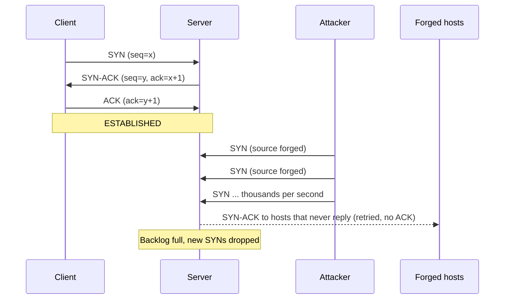

# Day 1: TCP three-way handshake and SYN floods

Day 1 · Networking foundations · ~10 min + optional 20 min lab

How a server spends memory on strangers, and how attackers make it run out.

## Warm-up recall

> This is lesson one, so there is nothing earlier to retrieve. Instead, do a pre-test: answer from memory before reading, even if you guess. Guessing first makes the correct answer stick better.

<details>
<summary>Q1. Which flags are set in each of the three handshake packets?</summary>

SYN; then SYN+ACK; then ACK. The client's ISN is x, the server's ISN is y. SYN-ACK acknowledges x+1, and the final ACK acknowledges y+1.

</details>

<details>
<summary>Q2. A SYN flood is a bandwidth attack. True or false?</summary>

Mostly false. A SYN is about 60 bytes on the wire. The scarce resource is the server's table of half-open connections (the backlog), not link capacity. A few thousand packets per second can fill it.

</details>

## The idea

TCP makes the server commit memory to a connection after receiving only one unauthenticated packet, and a SYN flood sends that packet many times and never finishes the conversation.

> **Analogy.** A restaurant holds a table for anyone who phones to reserve. If someone phones in 500 fake reservations and nobody shows up, every table is held for people who never arrive and real customers hear "we're full." Nobody broke in and no phone line was saturated.

## Why it matters

**Panix, September 1996.** The New York ISP Panix was knocked offline for several days by a flood of forged-source SYN packets, one of the first widely noticed denial-of-service attacks on a real service. CERT published advisory [CA-96.21](https://seclists.org/bugtraq/1996/Sep/61) on September 19, 1996, and the episode pushed SYN cookies and SYN caches into mainstream operating systems. Sources: [TBTF archive](https://www.tbtf.com/archive/0090.html), CERT advisory above.

## How it works

1. **Client sends SYN.** Flags `S`, a random initial sequence number x, and options (MSS, SACK-permitted, timestamps, window scale).
2. **Server allocates state.** It creates a half-open entry in the SYN queue (state `SYN-RECEIVED`), stores the client address, ports, x, and negotiated options, and replies with SYN-ACK carrying its own ISN y and `ack = x+1`.
3. **Server waits.** If no ACK arrives, it retransmits the SYN-ACK with exponential backoff. Linux retries `tcp_synack_retries` times (default 5), so one half-open entry can live for about a minute.
4. **Client sends ACK.** `ack = y+1`. The entry moves to the accept queue and the connection is `ESTABLISHED`. `accept()` hands it to the application.



*Top: the normal exchange. Bottom: forged SYNs fill the half-open queue, SYN-ACKs go to addresses that never reply, and legitimate clients are turned away.*

A SYN as the defender's packet capture shows it:

```text
IP 203.0.113.7.51744 > 192.0.2.10.443: Flags [S], seq 3081274923, win 64240,
   options [mss 1460,sackOK,TS val 11 ecr 0,nop,wscale 7], length 0
IP 192.0.2.10.443 > 203.0.113.7.51744: Flags [S.], seq 1749221330, ack 3081274924, win 65160,
   options [mss 1460,sackOK,TS val 99 ecr 11,nop,wscale 7], length 0
IP 203.0.113.7.51744 > 192.0.2.10.443: Flags [.], ack 1749221331, win 502, length 0
```

**Attacker sees**Whether the target answers SYN-ACK at all (open port) and whether responses slow down. With a spoofed source they see nothing back, so they infer success from the target's availability.

**Defender sees**Many `SYN_RECV` sockets, a low ratio of completed handshakes, SYN-ACK retransmits, and kernel counters rising. The source IPs are often random or from unrelated networks.

**SYN cookies, the key defense.** When the SYN queue is full, the server keeps no state. It encodes what it needs into the SYN-ACK's sequence number: a coarse timestamp, an index for the MSS, and a keyed hash of the connection 4-tuple and a secret. A real client echoes `y+1` in its ACK, the server recomputes the hash, and only then creates the connection. A spoofer never sees the SYN-ACK, so it cannot produce a valid ACK. See [RFC 4987](https://www.rfc-editor.org/rfc/rfc4987) sections 3.5 to 3.7 for SYN cache and cookies.

## Common misconceptions

- **"It saturates the link."** It exhausts per-connection state. That is why it can work with little traffic, and why upstream bandwidth scrubbing alone is not enough.
- **"A stateful firewall stops it."** The firewall has its own connection table that can be filled the same way. Putting it in front moves the bottleneck unless it also uses cookies or proxies the handshake (RFC 4987 section 3.8).
- **"Just raise the backlog or lower the timeout."** Both only change how many packets per second it takes. RFC 4987 section 3.3 notes a shorter SYN-RECEIVED timer can break legitimate slow clients, and attackers answer by sending faster.

## Attacker abuse

| Framework | ID | Meaning |
|---|---|---|
| MITRE ATT&CK | [T1499.001](https://attack.mitre.org/techniques/T1499%2F001/) | Endpoint Denial of Service: OS Exhaustion Flood (tactic Impact, TA0040). Mitigation M1037 explicitly lists enabling SYN cookies. |
| CWE | CWE-400, CWE-770 | Uncontrolled resource consumption; allocation of resources without limits or throttling. |

Typical tooling sends high-rate SYNs with random source ports and, where egress filtering is absent, spoofed source addresses. In practice, botnets also send non-spoofed SYNs from thousands of real hosts, which defeats source-based filtering. Contrast with volumetric floods, which map to a different technique (T1498.001).

## Defender playbook

- **Enable SYN cookies:** `sysctl net.ipv4.tcp_syncookies=1` (Linux default is typically 1, which means used when the queue overflows). Check `net.ipv4.tcp_max_syn_backlog` and `net.core.somaxconn`, and make sure the application's own `listen()` backlog is not tiny.
- **Egress and ingress filtering** (BCP 38, RFC 2827) so spoofed sources die at the edge.
- **Upstream mitigation:** CDN or scrubbing provider that terminates TCP and proxies to origin, so the origin only sees completed handshakes.
- **Rate limit new connections** per source at the load balancer, accepting that distributed floods evade per-source limits.

Kernel log line that signals the defense kicked in:

```text
TCP: request_sock_TCP: Possible SYN flooding on port 443. Sending cookies. Check SNMP counters.
```

Detection ideas. On a host:

```bash
ss -Hn state syn-recv '( sport = :443 )' | wc -l
nstat -az TcpExtTCPReqQFullDoCookies TcpExtTCPReqQFullDrop TcpExtListenOverflows TcpExtListenDrops
```

Sigma-style logic for firewall or flow logs (pseudo-rule, tune the thresholds to your baseline):

```text
title: Possible SYN flood against a single service
logsource: {category: firewall}
detection:
  syn_only:
    tcp_flags: 'SYN'          # SYN set, ACK not set
  condition: syn_only | count(src_ip) by dest_ip, dest_port > 500 within 1m
                        and ratio(syn_only, established) > 10
level: high
tags: [attack.impact, attack.t1499.001]
```

Suricata sketch (threshold-based, per destination):

```text
alert tcp any any -> $HOME_NET 443 (msg:"Possible SYN flood"; flags:S,12;
  threshold:type threshold, track by_dst, count 2000, seconds 10;
  classtype:attempted-dos; sid:1000001; rev:1;)
```

The high-signal metric is not packets per second but SYNs that never become ESTABLISHED.

## Hands-on lab (optional)

Everything runs against your own machine on loopback. Do not point any of this at hosts you do not own.

**Part A: watch a real handshake.**

```bash
# terminal 1: a listener
python3 -m http.server 8080 --bind 127.0.0.1
# terminal 2: capture
sudo tcpdump -i lo -nn -S 'tcp port 8080'
# terminal 3
curl -s http://127.0.0.1:8080/ -o /dev/null
```

Look for `[S]`, `[S.]`, `[.]`. With `-S`, tcpdump prints absolute sequence numbers so you can verify `ack = seq + 1` yourself.

**Part B: create half-open connections safely.** Send a small, fixed number of SYNs and never complete them. Scapy needs root; a count of 50 is plenty.

```python
pip install scapy --break-system-packages   # or use a venv
sudo python3 - <<'EOF'
from scapy.all import IP, TCP, send
import random
pkts = [IP(dst="127.0.0.1")/TCP(sport=random.randint(20000,60000), dport=8080, flags="S")
        for _ in range(50)]
send(pkts, verbose=0)
EOF
ss -Hn state syn-recv '( sport = :8080 )' | wc -l
nstat -az TcpExtTCPReqQFullDoCookies
```

On loopback the kernel replies with RSTs to the unsolicited SYN-ACKs, so entries may clear quickly. If you see few or none, that is itself the lesson: half-open entries live only if the SYN-ACK is never answered or reset, which is why attackers forge sources that do not exist. To go further, capture the SYN-ACK retransmits with tcpdump and compare their spacing to the backoff in step 3.

**Part C: read your own limits.**

```bash
sysctl net.ipv4.tcp_syncookies net.ipv4.tcp_max_syn_backlog net.ipv4.tcp_synack_retries net.core.somaxconn
```

Free practice: the TryHackMe [Wireshark: The Basics](https://tryhackme.com/room/wiresharkthebasics) room (check whether it is included in your plan) is a good place to practice reading handshakes and flags in a capture.

## Portfolio idea

Write a small Python script that parses a pcap (scapy or pyshark) and reports, per destination port, SYN count versus completed handshakes and SYN-ACK retransmits, flagging windows where the ratio exceeds a threshold. Publish it with a sample pcap you generated in the lab, plus the Sigma rule above, as `syn-flood-detector`.

## Teach it back

Explain to a non-technical colleague in 3 sentences why a flood of tiny, incomplete connection requests can take down a website.

<details>
<summary>Model answer</summary>

When your computer starts talking to a website, the website sets aside a little memory to remember you after your very first message. An attacker sends huge numbers of these first messages from fake addresses and never follows up, so the website's list of "people I'm waiting to hear from" fills up. Real visitors then get turned away, even though no data was stolen and the connection to the internet is fine.

</details>

## Self-check

<details>
<summary>1. Recall: In the handshake, what are the ack values in the SYN-ACK and the final ACK?</summary>

SYN-ACK acknowledges the client's ISN plus one (x+1). Final ACK acknowledges the server's ISN plus one (y+1). A SYN consumes one sequence number even though it carries no data.

</details>

<details>
<summary>2. Application: Why are SYN cookies immune to spoofed sources while a bigger backlog is not?</summary>

A bigger backlog still stores state per SYN, so spoofed SYNs still consume memory until it runs out. With cookies, no state is stored until a valid ACK returns. The ACK must carry a value that depends on a server secret and the 4-tuple, which a spoofer who never sees the SYN-ACK cannot produce.

</details>

<details>
<summary>3. Scenario: Your public web server shows the kernel message "Possible SYN flooding on port 443. Sending cookies" and users report timeouts. What do you do?</summary>

First confirm the pattern: count `SYN_RECV` sockets, check nstat drop counters, and look at flow logs for source diversity and handshake completion ratio. Cookies mean the backlog overflowed, but if users still fail, check whether the app's accept queue (`ListenOverflows`) or CPU is the limit. Then escalate to your CDN or ISP for upstream filtering or proxying, tighten per-source rate limits if sources are few, and record timeline and impact for the incident ticket. Do not simply disable cookies or lower timeouts as a first move.

</details>

## Go deeper

- [RFC 4987: TCP SYN Flooding Attacks and Common Mitigations](https://www.rfc-editor.org/rfc/rfc4987)
- [RFC 9293: Transmission Control Protocol (state machine and handshake)](https://www.rfc-editor.org/rfc/rfc9293)
- [MITRE ATT&CK T1499.001](https://attack.mitre.org/techniques/T1499%2F001/) and its [detection strategy DET0356](https://attack.mitre.org/detectionstrategies/DET0356)

**Where this shows up in your work:** NIST SP 800-53 SC-5 (Denial-of-Service Protection) and SOC 2 Availability criteria (capacity and resilience commitments, A1.x) are the controls a SYN flood tests.

**Certification objectives:** reinforces Security+ network attacks, DDoS and secure network design, and CySA+ network traffic analysis and indicators of malicious activity.

Day 2 preview: DNS resolution, caching, and DNS attacks.
