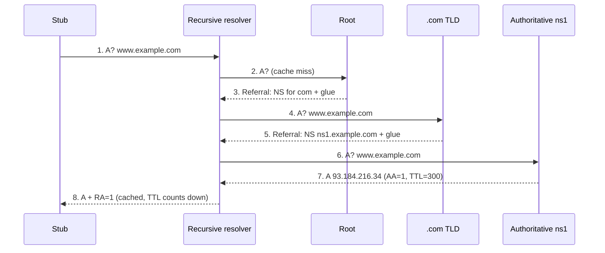
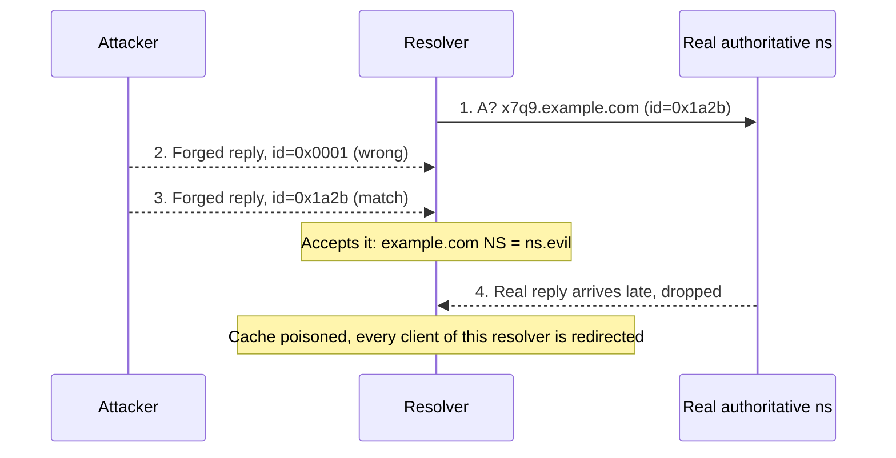

# Day 2: DNS resolution, caching, and attacks

## Warm-up recall (2 min)

Answer from memory first, out loud or on paper. Then open the answer. Retrieval effort is what makes it stick.

**Q-A (Day 1: TCP/IP):** A client sends a SYN with sequence number x. What exactly does the server send back, which flags and which acknowledgment number, and which server resource does a SYN flood exhaust? What do SYN cookies change?

<details>
<summary>Show answer</summary>

The server replies SYN-ACK (flags SYN+ACK) with its own initial sequence number y and acknowledgment number x+1. It also allocates a half-open connection entry (the SYN queue / backlog) and waits for the final ACK. A flood of spoofed SYNs fills that queue, so real clients get dropped.

SYN cookies encode the connection parameters into the server's ISN (y) and keep no state until the client's ACK comes back with y+1. The server validates the cookie then, and only then allocates a connection.

</details>

Q-B is skipped: there is no topic 7 to 14 lessons back yet. It starts appearing around Day 9.

## Threat feed (3 min)

Window: Oct 20 to 23, 2026. Three items verified this run. Another AI-security item I found (prompt injection hidden in HTTP headers, The Register, Oct 15) is outside the 3 to 5 day window, so it is left out.

`[CRIT]` `[NEW]` `KEV` `CWE-918` `CWE-73`

### Plex2Shell: four chained Plex Media Server bugs now exploited in the wild

*Oct 21, 2026 (CISA KEV addition) · Field Effect · [Active exploitation of Plex2Shell vulnerabilities](https://fieldeffect.com/blog/active-exploitation-plex2shell-vulnerabilities)*

A researcher published a write-up and proof of concept on Oct 16, and attackers were exploiting it the next day. The chain (CVE-2026-96652, -96654, -96655, -96656) yields unauthenticated code execution, with a chain score of CVSS 9.8. Observed payloads include crypto miners and proxy malware. Fixes shipped Aug 3 to 4 (Plex Media Server 1.43.3.10861 or later), and Shadowserver counted 36,000+ unpatched instances in early September.

**TECHNICAL TAKEAWAY ▸** Two SSRF bugs plus a URL injection make the server fetch attacker-controlled content and obtain an admin token. An arbitrary file write then drops a shared library into the Codecs directory that the server loads. Medium-severity bugs chain into critical impact. Needs TCP/32400 reachable. `relates to: cloud misconfigurations lesson (SSRF)`

`[WARN]` `[INFO]` `DNS`

### BIND, PowerDNS and Unbound ship coordinated resolver fixes

*Fixes released Oct 21, reported Oct 22, 2026 · LinuxSecurity · [BIND, PowerDNS and Unbound Patch DNS Resolver Security Flaws](https://linuxsecurity.com/news/network-security/dns-security-resolver-patches)*

BIND fixes CVE-2026-19630 (crafted messages cause excessive CPU and memory use) and CVE-2026-94300 (memory corruption that could allow code execution, needing a replayed GSS-TSIG message plus crafted queries). Unbound fixes CVE-2026-50106 (a DNSSEC validation bypass for trust islands). PowerDNS reports a flaw that could skip DNSSEC signature checks and enable cache poisoning in specific cases. ISC says it knows of no active exploits for the two BIND bugs. Fixed builds: BIND 9.20.30 / 9.21.27, Unbound 1.26.2, PowerDNS Recursor 5.3.12 / 5.4.8.

**TECHNICAL TAKEAWAY ▸** Resolvers parse untrusted packets from the whole internet (compressed names, DNSSEC records). The classes here are resource exhaustion, memory safety, and validation logic. The validation-skip bugs are today's lesson in miniature: if the check that authenticates an answer fails open, poisoning is back. `relates to Day 2`

`[CRIT]` `[NEW]` `AI-driven intrusion` `supply chain`

### Storm-0940 uses an open-source agentic AI framework against 2,250+ Microsoft 365 tenants

*Oct 22, 2026 · CSO Online, citing Microsoft Threat Intelligence · [China-linked hackers used agentic AI in attack on 2,250 Microsoft 365 tenants](https://csoonline.com/article/4239028/china-linked-hackers-used-agentic-ai-in-attack-on-2250-microsoft-365-tenants.html)*

Microsoft attributes the activity to Storm-0940, a China-state-aligned actor. The group compromised a ConnectWise cloud backup application, then used credentials stolen there to authenticate as ConnectWise cloud apps that customers had already granted access. Sign-in attempts ran at roughly 2,900 per minute, and privileged access came in under three hours in some cases. Agents then used Microsoft Graph to add application credentials, edit groups and roles. Microsoft says its own systems were not compromised. The article lists no CVEs or ATT&CK IDs.

**TECHNICAL TAKEAWAY ▸** No user sign-in was needed: the attackers rode pre-authorized service principals. Added app credentials can persist after the original app is fixed, so defenders hunt by application ID and audit changes to roles and credentials. `relates to: OAuth lesson`

> **GRC angle**
>
> Storm-0940 is a vendor-risk story. Ask: which third-party SaaS apps hold standing permissions in our tenant, what is our inventory and review cadence for them, and does the vendor contract require breach notification fast enough to act on a 3-hour attack window?

## The idea

**DNS is a distributed, cached, mostly unauthenticated lookup service: you ask a helper to chase referrals down a tree, and it believes whatever answer looks right.**

Analogy: a librarian (the recursive resolver) gets asked for a book's shelf location. If they have not memorized it, they ask the front desk, then the floor desk, then the section clerk, and they write the answer on a sticky note for the next person. If a forger slips them a fake note that looks like a real reply, every later visitor gets sent to the wrong shelf until the note expires.

## Why it matters

> **2008 · CVE-2008-1447**
>
> In July 2008, Dan Kaminsky's coordinated disclosure revealed that nearly every recursive resolver could be poisoned in seconds, because answers were authenticated only by a 16-bit transaction ID and a predictable source port. Vendors shipped patches across the industry in one synchronized release (see Debian DSA-1603-1, GLSA 200807-08). The fix was source-port randomization. Impact: an attacker could redirect any domain, including banking and email, for every user of a vulnerable ISP resolver.

## How it works

### 3a. Resolution: the walk down the tree



*Cyan arrows are queries, green arrows are replies. Steps 3 and 5 are referrals, not answers: the resolver follows them. Only step 7 carries the authoritative answer (AA flag). Scroll sideways on a phone.*

1. **Stub to recursive resolver.** The OS sends one UDP/53 query with RD (recursion desired) set. The stub trusts the resolver completely.
2. **Cache check.** A hit returns immediately with the remaining TTL. This is why DNS is fast, and why a poisoned entry lasts.
3. **Iterate from the root.** The resolver already knows root server addresses (the root hints). The root does not answer; it refers you to `.com` name servers, with glue A records so you can reach them.
4. **TLD then authoritative.** The same pattern repeats until a server sets AA=1 and returns the record.
5. **Cache and reply.** Answers, referrals and glue are cached according to their TTLs. The reply carries RA (recursion available).

**`dig +norecurse @1.1.1.1 example.com (trimmed)`**

```bash
;; flags: qr rd ra; QUERY: 1, ANSWER: 1, AUTHORITY: 0
;; ANSWER SECTION:
example.com.    212   IN   A   93.184.216.34   ; TTL already counting down = served from cache
```

> **Attacker sees**
>
> A resolver that sends predictable queries: fixed source port, sequential transaction IDs, no cache entry for the name it wants to poison. It also sees which domains a victim network resolves, by watching or inducing queries.

> **Defender sees**
>
> Resolver logs with one client asking, many upstream queries per name; flags and rcodes (NOERROR, NXDOMAIN, SERVFAIL); TTLs; and in Zeek `dns.log`, query name, type, answers and TTLs per client.

### 3b. Why poisoning works: a race over two small secrets

A UDP DNS response is accepted if it matches the question and arrives from the expected server address on the expected port with the right 16-bit transaction ID. The attacker can spoof the source IP, so only the ID and port are secrets. That is about 16 bits when the port is fixed.



*The attacker triggers a query for a random, uncached name so the race starts on demand, then floods forged replies (magenta dashed). A matching ID wins. The forged reply's authority and glue sections rewrite the delegation of the whole zone. This is Kaminsky's insight.*

**Entropy math.** Transaction ID only: 2<sup>16</sup> = 65,536 guesses. Add a randomized source port (about 2<sup>16</sup> more): about 2<sup>32</sup> ≈ 4.3 billion. That is why port randomization was the emergency fix.

### 3c. Tunneling: DNS as a covert pipe

Recursive resolvers forward any query for any name. An attacker who owns `evil.example` and its authoritative server can encode data into subdomain labels (up to 63 octets each, 253 per name) and receive replies in TXT or other record types. Tools such as iodine and dnscat2 do this. Nothing needs a direct outbound connection, because the victim's own resolver relays the traffic.

**`zeek dns.log (illustrative)`**

```text
#fields ts id.orig_h query qtype_name rcode_name answers TTLs
1761234001.12  198.51.100.23  mfrggzdfmztwq2lknnwg23tpobyxe43uov3ho6dzpi.t.evil.example  TXT  NOERROR  "ZGF0YQ=="  0
1761234001.31  198.51.100.23  nbswy3dpeb3w64tmmqqho33snrsca5dpon2gk4tdn5.t.evil.example  TXT  NOERROR  "bW9yZQ=="  0
... 3,800 similar lines/hour, one parent domain, high-entropy labels, TTL 0
```

## Common misconceptions

- **"DNSSEC encrypts DNS."** No. DNSSEC signs records so a validating resolver can prove they came from the zone owner (the `ad` flag). Queries and answers remain readable. Confidentiality is DoT/DoH, and those protect only the stub-to-resolver hop, not data authenticity upstream.
- **"DNS is UDP only."** Responses that do not fit set TC=1 and the client retries over TCP. Zone transfers (AXFR) use TCP, and DoT/DoH ride TCP/TLS. Blocking TCP/53 breaks DNS in subtle ways, and tunnels use both.
- **"Poisoning means the attacker hacked the domain's DNS server."** No. The authoritative server is untouched. The attacker only forges a believable answer into one resolver's cache, so the damage is scoped to that resolver's users, for as long as the TTL lasts.

## Attacker abuse

`T1071.004 · DNS (C2, parent T1071)` `T1568 · Dynamic Resolution (T1568.002 DGA)` `T1584.002 · Compromise Infrastructure: DNS Server` `CWE-330 · Insufficiently Random Values`

- **Cache poisoning** exploits weak randomness in transaction ID and source port (CWE-330, CVE-2008-1447), then redirects users to phishing or malware hosts.
- **C2 and exfiltration over DNS** (T1071.004) blends into traffic that almost every network allows. Malware also uses DGAs (T1568.002) to rotate rendezvous domains.
- **Hijacking DNS infrastructure** (T1584.002): taking over a registrar account or name server changes answers at the source, with no race needed.

## Defender playbook

### Prevent

- Patch resolvers promptly (see the BIND/Unbound/PowerDNS items above); keep them updated and not exposed as open resolvers.
- Use source-port and transaction-ID randomization, and 0x20 case randomization and DNS cookies where supported. RFC 5452 lists the resolver measures.
- Enable DNSSEC validation on your resolvers and sign your own zones. Registrar lock plus MFA on the registrar account.
- Force endpoints through your own resolver (block outbound 53/853 to everything else), and apply response policy zones or a protective DNS service.

### Detect

**`dns_long_query_tunnel.yml (Sigma sketch)`**

```yaml
title: Possible DNS Tunneling - Long Encoded Subdomain
status: experimental
logsource:
  category: dns
detection:
  selection:
    query|re: '^[a-z0-9+/=_-]{40,}\.[^.]+\.[^.]+$'
  filter_known:
    query|endswith: ['.in-addr.arpa', '.cloudfront.net']
  condition: selection and not filter_known
falsepositives: [CDN and antivirus lookup domains, tune with allowlist]
level: medium
tags: [attack.command_and_control, attack.t1071.004]
```

**`suricata sketch (untested, tune before use)`**

```text
alert dns $HOME_NET any -> any any (msg:"Long DNS label (possible tunnel)"; \
  dns.query; pcre:"/^[a-z0-9]{50,}\./i"; \
  threshold:type both, track by_src, count 20, seconds 60; \
  sid:1000001; rev:1;)
```

Beyond single-query rules, hunt on aggregates: queries per client per parent domain, unique subdomain counts, label entropy, TXT/NULL record share, and TTL=0 replies. The ATT&CK detection note for T1071.004 also suggests watching DNS from non-browser processes such as PowerShell or Python.

> **Poisoning signals**
>
> Many NXDOMAIN lookups for random names under one victim zone, followed by a sudden NS or glue change in the resolver cache, is the Kaminsky fingerprint. Alert on a spike of upstream queries for one zone and on unexpected delegation changes.

## Hands-on lab (optional)

All steps run against public resolvers as a normal client or on your own machine. Nothing here attacks anything.

### Part 1: watch the walk and the cache

**`terminal`**

```bash
# follow referrals root -> TLD -> authoritative (what your resolver does)
dig +trace www.example.com

# ask a cache only; run it twice, 10s apart, and watch the TTL drop
dig +norecurse @1.1.1.1 example.com A
sleep 10; dig +norecurse @1.1.1.1 example.com A

# does your resolver validate DNSSEC? look for the "ad" flag
dig +dnssec example.com A @1.1.1.1 | grep flags
dig +dnssec dnssec-failed.org A @1.1.1.1 | grep -E 'status|flags'
```

Look for: referrals with no answer section in the trace; a decreasing TTL on the second query; `ad` in flags for a signed zone; and `status: SERVFAIL` for the deliberately broken `dnssec-failed.org` on a validating resolver.

### Part 2: see the secrets on the wire

**`terminal A / terminal B`**

```bash
# terminal A
sudo tcpdump -ni any -vv 'udp port 53' -c 6

# terminal B (repeat a few times)
dig +norecurse @1.1.1.1 example.com A
dig +norecurse @1.1.1.1 example.org A
```

Look for: `id` (transaction ID) differing per query, and the client's UDP source port changing per query. Those two numbers are the 32 bits of entropy from section 3b. In Wireshark use `dns.id`, `dns.flags.response == 1`, and `dns.qry.name.len > 50`.

### Part 3: build a tunnel detector (safe, offline)

**`dns_entropy.py`**

```python
import math, collections, sys

def entropy(s):
    c = collections.Counter(s)
    return -sum(v/len(s) * math.log2(v/len(s)) for v in c.values())

for line in sys.stdin:           # one query name per line
    name = line.strip().lower()
    label = name.split(".")[0]
    if len(label) >= 20 and entropy(label) > 3.5:
        print(f"SUSPECT {entropy(label):.2f} {name}")
```

**`test it`**

```bash
printf '%s\n' www.example.com mail.example.com \
 mfrggzdfmztwq2lknnwg23tpobyxe43uov3ho6dzpi.t.evil.example \
 | python3 dns_entropy.py
```

Look for: only the third name flagged. Then try to break it with a long legitimate name (a CDN hostname) and think about how to cut false positives.

**Free practice:** TryHackMe's [DNS in Detail](https://www.tryhackme.com/room/dnsindetail) room covers record types and resolution flow hands-on.

## Portfolio idea

Publish `dns-tunnel-hunter`: your entropy script extended to read a Zeek `dns.log`, group by client and parent domain, score by label length, entropy, TXT share and query rate, and output a ranked CSV. Ship the Sigma rule above, a README with ATT&CK mapping, and a sample log you generated yourself.

## Teach it back

Explain DNS poisoning to a non-technical colleague in 3 sentences. Write it before you open the model answer.

<details>
<summary>Show answer</summary>

DNS is the internet's phone book: your provider's lookup server asks a chain of other servers for an address and remembers the answer for a while. An attacker can slip a fake answer to that lookup server before the real one arrives, and because the server accepts the first answer that looks right, it then sends everyone to the attacker's site. We defend with randomness that makes the fake hard to guess, signatures (DNSSEC) that make fakes provable, and monitoring for odd lookups.

</details>

## Self-check

**Q1 (recall):** A resolver receives a UDP response. List what it checks before accepting it, and which of those the attacker cannot see.

<details>
<summary>Show answer</summary>

It matches the question section (name, type, class), the source IP and destination port against the outstanding query, and the 16-bit transaction ID. A blind attacker can spoof the source IP and knows the question, so the secrets are the transaction ID and (once randomized) the source port. Case randomization (0x20) adds a few more bits.

</details>

**Q2 (application):** An attacker sends 100 forged replies per race. Compare the success chance per race with ID-only entropy versus ID plus port.

<details>
<summary>Show answer</summary>

ID only: 100 / 65,536 ≈ 0.15% per race, and Kaminsky's random-subdomain trick lets the attacker run races back to back with no TTL wait. ID plus port: 100 / 2<sup>32</sup> ≈ 2.3 × 10<sup>-8</sup>, about 1 in 43 million per race. Rough numbers, since the usable port range is slightly under 2<sup>16</sup>, but the point stands: the attack moves from seconds to impractical without huge volume.

</details>

**Q3 (scenario):** Your SIEM flags a laptop sending ~4,000 TXT queries per hour to random-looking subdomains of one domain registered 3 days ago, with TTL=0 answers. What do you do?

<details>
<summary>Show answer</summary>

Treat it as probable DNS C2 or exfiltration (T1071.004). Steps: (1) pull the process behind the queries from EDR, because DNS logs alone do not name the process; (2) sinkhole or block the parent domain at the resolver while preserving logs and a PCAP; (3) isolate the host if the process is unknown; (4) scope: query all clients for the same parent domain and look at the data volume encoded; (5) check domain age and registrar via passive DNS; (6) after eradication, add a detection and record lessons learned. Do not just block the domain and close the ticket.

</details>

## Go deeper

- [RFC 5452: Measures for Making DNS More Resilient against Forged Answers](https://www.rfc-editor.org/rfc/rfc5452) (the resolver-side defense checklist).
- [MITRE ATT&CK T1071.004: Application Layer Protocol: DNS](https://attack.mitre.org/techniques/T1071/004) (includes detection guidance).
- [RFC 1035: Domain Names, Implementation and Specification](https://www.rfc-editor.org/rfc/rfc1035) (message format, flags, compression).

> **Where this shows up in your work**
>
> Maps to NIST SP 800-53 SC-20/SC-21/SC-22 (secure name resolution) and SI-4 (system monitoring), and to SOC 2 CC6.6 and CC7.2 (boundary protection, anomaly monitoring).

**Cert objectives:** reinforces Security+ (network attacks, secure protocols, DNS security), CySA+ (network traffic analysis, indicators of malicious activity), and Pentest+ (reconnaissance and enumeration).

See you tomorrow. **Day 3 teaser:** TLS 1.3 handshake, step by step. Which of today's DNS secrets does TLS refuse to rely on?

**Sources:** [Field Effect: Plex2Shell](https://fieldeffect.com/blog/active-exploitation-plex2shell-vulnerabilities) · [LinuxSecurity: DNS resolver patches](https://linuxsecurity.com/news/network-security/dns-security-resolver-patches) · [CSO Online: Storm-0940](https://csoonline.com/article/4239028/china-linked-hackers-used-agentic-ai-in-attack-on-2250-microsoft-365-tenants.html) · [MITRE T1071.004](https://attack.mitre.org/techniques/T1071/004) · [MITRE T1568](https://attack.mitre.org/techniques/T1568/) · [CWE-330](https://cwe.mitre.org/data/definitions/330.html) · [RFC 5452](https://www.rfc-editor.org/rfc/rfc5452)
