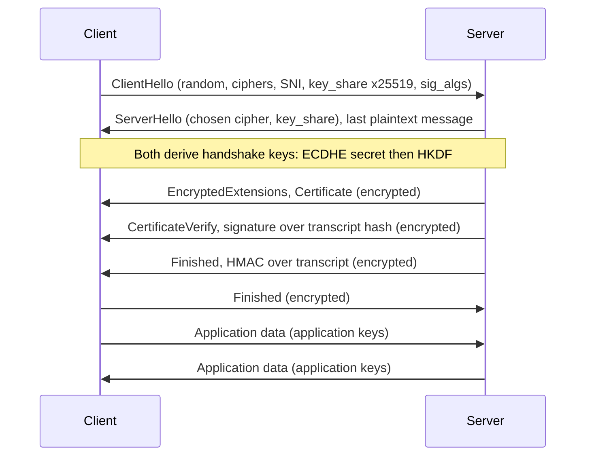

# Day 3: The TLS 1.3 handshake

## Warm-up recall

Two minutes. Answer from memory first, then reveal. Retrieval is the learning, not the reading.

**Q-A (Day 2, DNS):** A resolver sends a query for `www.example.com` and an off-path attacker wants to poison its cache. Which two fields in the DNS response must the attacker guess, and why did Kaminsky's 2008 attack make guessing practical?

<details>
<summary>Show answer</summary>

The 16-bit transaction ID and the UDP source port the resolver used. Before source-port randomisation, only the 16-bit ID mattered (65,536 values). Kaminsky asked for many random non-existent subdomains (`aaaa1.example.com`, ...), so each query was a fresh race that did not hit the cache, and the forged reply put the attacker's NS and glue records in the authority/additional sections. Port randomisation, 0x20 encoding, and DNSSEC raise the cost or remove the attack.

</details>

No Question B today: no lesson exists yet 7 to 14 lessons back.

## Threat feed

Verified via search on 2026-10-24. Only 3 items passed verification; I could not verify a fresh AI-security or policy item inside the 3 to 5 day window, so none is shown.

### `[CRIT]` `[NEW]` Arista VeloCloud Orchestrator SQL injection exploited as a zero-day

*Oct 22, 2026 · BleepingComputer · [link](https://www.bleepingcomputer.com/news/security/arista-patches-new-velocloud-orchestrator-zero-day-exploited-in-attacks/) · `CVE-2026-114625` `SQLi`*

Arista patched a critical flaw in the on-prem VeloCloud Orchestrator web interface that is being exploited in attacks. Any authenticated user can escalate to a "local superuser operator". Fixed releases named: 5.2.3.18, 6.1.3.10 and 6.4.2.12 or later. Arista advises restricting the web UI to admin networks and blocking two listed IPs.

> **Technical takeaway:** SQL injection in a management plane turns "low-privilege login" into full control. Same root cause as the SQL injection lesson coming up on Day 8, so this will be a good revisit. The article does not give a CWE, so I am not assigning one.

### `[WARN]` `[NEW]` Capcom: 11.7M CAPCOM ID accounts exposed

*Oct 22, 2026 · BleepingComputer · [link](https://www.bleepingcomputer.com/news/security/capcom-confirms-data-breach-affecting-117-million-accounts/) · `T1078 context only`*

Capcom confirmed unauthorised access on Oct 19. Over 11.7 million email addresses plus creation dates, login counts and last-login IPs were exposed. Attackers changed passwords on 196 accounts, which Capcom reset. Initial access method is undisclosed.

> **Technical takeaway:** Passwords were reportedly not exposed, but the last-login IPs and emails are a ready phishing and credential-stuffing list. TLS protects data in transit only; it does nothing once the identity database itself is read.

### `[CRIT]` Zeabur shuts down after second breach in two months

*Oct 20, 2026 · BleepingComputer · [link](https://www.bleepingcomputer.com/news/security/zeabur-shutting-down-after-second-security-breach-in-two-months/)*

An attacker used plaintext internal admin credentials and cloud keys on Oct 14 to 15. About 3.2 million environment-variable records were taken, with root sign-ins on 101 GCP servers. Admin tokens never expired and were last rotated in January 2024, so a post-August rotation missed them.

> **Technical takeaway:** Long-lived static secrets outlive the incident that leaked them. TLS 1.3's per-session ephemeral keys are the opposite design: nothing durable to steal. `relates to Day 3`

> **GRC angle**
>
> Zeabur is a textbook vendor-risk question: do your SaaS and PaaS suppliers enforce credential rotation and expiry on admin tokens, and are customer env vars treated as secrets in their SOC 2 scope (CC6.1, CC6.6)? Ask for the rotation policy, not just the report.

`[INFO]` Standards note (not breaking news, Aug 2026): RFC 10024 now standardises hybrid post-quantum key exchange for TLS 1.3. Covered in the lesson below. [rfc-editor.org](https://www.rfc-editor.org/rfc/rfc10024)

## The idea

**One sentence:** TLS 1.3 lets two strangers agree on a fresh shared secret, prove the server's identity, and start sending encrypted data after just one network round trip, with everything after the ServerHello already encrypted.

**Analogy:** Two people shout half a paint recipe across a crowded room, each mixing in a private colour only they know. Both end up with the same final shade; eavesdroppers who heard everything cannot reproduce it. Then the server shows a notarised ID card, signed over a summary of the whole conversation so nobody can swap parts mid-way.

## Why it matters

**Heartbleed (CVE-2014-0160), 2014:** an OpenSSL bug in the TLS heartbeat extension let attackers read up to 64 KB of server memory per request, including private keys and session data. It showed that a long-lived RSA private key plus no forward secrecy means one memory leak can decrypt recorded traffic. TLS 1.3 removed static-RSA key exchange and mandates ephemeral key exchange, so a stolen server key no longer decrypts past sessions.

## How it works



*Fig 1. Only ClientHello and ServerHello cross the wire in plaintext; everything after is encrypted. One round trip before data flows.*

1. **ClientHello.** The client sends 32 random bytes, a list of cipher suites (TLS 1.3 only has five AEAD suites, such as `TLS_AES_128_GCM_SHA256`), the `supported_versions` extension (0x0304), SNI, and crucially a guessed `key_share`: an ephemeral X25519 public key. Guessing up front is what saves the extra round trip TLS 1.2 needed.
2. **ServerHello.** The server picks a suite and returns its own ephemeral `key_share`. Both sides now compute the same ECDHE shared secret. If the client guessed a group the server dislikes, the server sends HelloRetryRequest and costs one extra round trip.
3. **Key schedule.** The shared secret goes through HKDF-Extract and HKDF-Expand with a hash of the transcript so far, producing handshake traffic secrets. From here on, the handshake is encrypted. Middleboxes can no longer read the certificate.
4. **EncryptedExtensions, Certificate, CertificateVerify.** The server sends its X.509 chain, then a signature over the transcript hash. This is what proves it holds the private key for the certificate, and ties the proof to *this* handshake so it cannot be replayed.
5. **Finished (both sides).** Each sends an HMAC over the full transcript. Any tampering, such as stripping a stronger cipher from the ClientHello, makes the transcripts differ and the handshake fails. This is the downgrade defence.
6. **Application data.** New application traffic secrets are derived. Keys rotate with `KeyUpdate`. The ephemeral private keys are discarded, which is forward secrecy.

**`clienthello.txt (Wireshark view, abridged)`**

```text
TLSv1.3 Record Layer: Handshake Protocol: Client Hello
  Version: TLS 1.0 (0x0301)         # legacy_record_version, ignored
  Handshake Type: Client Hello (1)
  Version: TLS 1.2 (0x0303)         # legacy_version, real one below
  Cipher Suites: TLS_AES_128_GCM_SHA256 (0x1301), ...
  Extension: server_name  -> example.com
  Extension: supported_versions -> TLS 1.3 (0x0304)
  Extension: supported_groups -> x25519, secp256r1
  Extension: key_share -> x25519, 32 bytes
  Extension: signature_algorithms -> ecdsa_secp256r1_sha256, ...
```

> **ATTACKER SEES (passive, on path)**
>
> ClientHello in clear: SNI hostname, offered suites, key shares. After ServerHello: only record sizes and timing. Certificates are no longer visible.

> **Defender sees**
>
> Same metadata. TLS inspection needs to be an endpoint proxy; JA3/JA4 fingerprints of the ClientHello still identify client software and malware families.

> **Tip: 0-RTT**
>
> TLS 1.3 can send early data using a PSK from a prior session. It is not forward-secret and is replayable, so only allow it for idempotent requests (RFC 8446 section 8).

## Common misconceptions

- **"The handshake encrypts with the certificate's key."** No. The certificate key only signs (CertificateVerify). The session keys come from ephemeral ECDHE. This is what makes forward secrecy mandatory in 1.3.
- **"HTTPS means the site is safe."** Phishing sites get valid certificates for free. TLS authenticates the domain, not the intent.
- **"TLS 1.3 hides everything."** SNI, IPs, packet sizes and timing remain visible. Encrypted Client Hello (ECH) exists but is not universally deployed.

## Attacker abuse

`T1573 Encrypted Channel` `T1071.001 Web Protocols` `T1557 Adversary-in-the-Middle` `CWE-295 Improper Certificate Validation` `CWE-327 Broken Crypto`

Attackers rarely break TLS 1.3 itself. They use it (C2 hidden inside HTTPS, T1573), attack validation (apps that skip certificate checks, CWE-295), bring a rogue or stolen certificate, or downgrade clients still offering old versions. Memory-safety bugs in the library (Heartbleed) hit the implementation, not the protocol. Harvest-now-decrypt-later targets recorded traffic whose key exchange a future quantum computer could break, which is why **RFC 10024** adds the hybrid group `X25519MLKEM768` (codepoint 0x11EC) to TLS 1.3.

## Defender playbook

- Disable TLS 1.0/1.1, prefer 1.3, allow 1.2 only with ECDHE + AEAD suites.
- Strict certificate validation in every client; no `verify=False` in code reviews.
- Short-lived certificates, automated renewal, and monitoring via Certificate Transparency logs.
- Keep OpenSSL and other TLS libraries patched; inventory where they are embedded.
- Plan for hybrid PQ key exchange on high-value endpoints.

**`detections.txt`**

```text
# Zeek ssl.log hunting ideas
cat ssl.log | zeek-cut id.orig_h server_name version cipher \
  | awk '$3 != "TLSv13" && $3 != "TLSv12"'     # legacy versions

# Suricata sketch: flag TLS to a bare IP (no SNI)
alert tls $HOME_NET any -> $EXTERNAL_NET 443 (msg:"TLS no SNI"; \
  tls.sni; content:!"."; sid:1000003; rev:1;)
```

## Hands-on lab (optional)

`[INFO]` Optional, 15 to 25 min. Needs `openssl` and optionally Wireshark. Own machine only.

**`lab.sh`**

```bash
# 1. Make a throwaway cert and run a local TLS 1.3-only server
openssl req -x509 -newkey ec -pkeyopt ec_paramgen_curve:prime256v1 \
  -nodes -keyout k.pem -out c.pem -subj "/CN=localhost" -days 1
openssl s_server -accept 4433 -cert c.pem -key k.pem -tls1_3 -www &

# 2. Connect and watch the handshake messages
openssl s_client -connect localhost:4433 -tls1_3 -msg -servername localhost </dev/null 2>&1 | head -80

# 3. Try forcing TLS 1.2 against the 1.3-only server
openssl s_client -connect localhost:4433 -tls1_2 </dev/null 2>&1 | grep -i -E "alert|protocol"

# 4. Optional: capture and filter in Wireshark
sudo tcpdump -i lo -w tls.pcap port 4433    # then open tls.pcap, filter: tls.handshake
```

Look for: `ClientHello`, `ServerHello`, then `EncryptedExtensions` and `Certificate` shown by `-msg` after decryption, but opaque "Application Data" records in the pcap. Step 3 should show a protocol version alert.

Free practice: [Cloudflare TLS overview](https://www.cloudflare.com/learning/ssl/transport-layer-security-tls/) (reading) is a gentle companion; I did not verify a dedicated TLS lab room today, so none is listed.

## Portfolio idea

Write a small Python script using the `ssl` module that scans your own domains and reports negotiated TLS version, cipher, cert expiry and days left, outputs a CSV, and runs in a GitHub Action. Add a README mapping results to SOC 2 CC6.7.

## Teach it back

Explain the TLS 1.3 handshake to a non-technical colleague in 3 sentences.

<details>
<summary>Show answer</summary>

Your browser and a website agree on a secret code in a way that onlookers cannot work out, even though they hear the whole exchange. The site then proves who it is with a digital ID that is checked against the conversation so far. After that, everything is scrambled with the secret code, and the code is thrown away afterwards so old recordings stay unreadable.

</details>

## Self-check

**Q1 (recall).** Which handshake messages are sent in plaintext in TLS 1.3?

<details>
<summary>Show answer</summary>

Only ClientHello and ServerHello (plus HelloRetryRequest, which is a ServerHello variant). EncryptedExtensions, Certificate, CertificateVerify and Finished are encrypted under handshake keys.

</details>

**Q2 (application).** Why does TLS 1.3 give forward secrecy by design while TLS 1.2 with RSA key exchange does not?

<details>
<summary>Show answer</summary>

In 1.2 RSA key exchange, the client encrypts the premaster secret to the server's long-term key, so one stolen key decrypts all recorded sessions. TLS 1.3 removed it and always uses ephemeral (EC)DHE; the certificate key only signs, and the ephemeral private values are discarded.

</details>

**Q3 (scenario).** A vendor's mobile app talks to its API over HTTPS, but a pen test shows traffic can be intercepted by a proxy with a self-signed cert. What happened and what do you require?

<details>
<summary>Show answer</summary>

The app is not validating the certificate chain or hostname (CWE-295), often via a debug flag left on. Require a fix and retest, enforce platform trust validation, consider certificate pinning for high-risk apps with a rotation plan, and ask for secure SDLC evidence that verification bypasses are blocked in release builds.

</details>

## Go deeper

- [RFC 8446: TLS 1.3](https://datatracker.ietf.org/doc/html/rfc8446) (sections 2 and 7 for the handshake and key schedule)
- [RFC 10024: PQ/T hybrid key agreement for TLS 1.3](https://www.rfc-editor.org/rfc/rfc10024)
- [The Illustrated TLS 1.3 Connection](https://tls13.xargs.org/) (byte-by-byte walkthrough)

**Where this shows up in your work:** NIST SP 800-53 SC-8 and SC-13, and SOC 2 CC6.7 (encryption of data in transit), plus certificate lifecycle evidence for vendor reviews.

**Certs reinforced:** Security+ (cryptographic solutions, PKI), CySA+ (network traffic analysis), Pentest+ (identifying weak crypto config).

See you tomorrow. Next up: **Day 4, Public-key vs symmetric crypto, and why both are used together.**

Sources: [BleepingComputer (Arista)](https://www.bleepingcomputer.com/news/security/arista-patches-new-velocloud-orchestrator-zero-day-exploited-in-attacks/) · [BleepingComputer (Capcom)](https://www.bleepingcomputer.com/news/security/capcom-confirms-data-breach-affecting-117-million-accounts/) · [BleepingComputer (Zeabur)](https://www.bleepingcomputer.com/news/security/zeabur-shutting-down-after-second-security-breach-in-two-months/) · [RFC 10024](https://www.rfc-editor.org/rfc/rfc10024)
