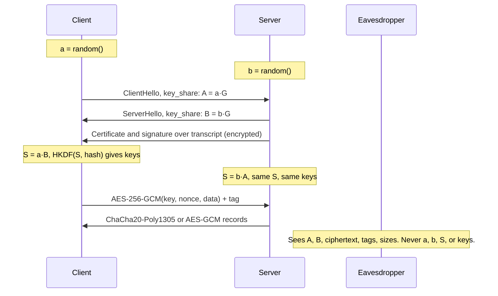

# Day 4: Public-key vs symmetric crypto, and why both are used together

## Warm-up recall (2 min)

Try answering from memory first. Say it out loud or type it, then reveal. The struggle is what makes it stick.

**Question A (Day 3, TLS 1.3 handshake):** Which handshake message first carries key material from each side, and which messages after ServerHello are already encrypted? Why does TLS 1.3 give forward secrecy by default?

<details>
<summary>Show answer</summary>

ClientHello and ServerHello each carry a `key_share` extension holding an ephemeral (EC)DHE public value, for example X25519. After ServerHello both sides derive the handshake secret, so EncryptedExtensions, Certificate, CertificateVerify and Finished travel encrypted under handshake traffic keys.

Forward secrecy is the default because TLS 1.3 removed static RSA key exchange. Every session uses fresh ephemeral keys that are thrown away, so stealing the server's long-term key later does not decrypt recorded traffic. Today's lesson explains what that ephemeral exchange actually is.

</details>

Question B: skipped. There is no lesson 7 to 14 days back yet. It starts appearing around Day 8.

## Threat feed

`[CRIT]` `[NEW]` `CWE-89` `exploited in the wild`

### Arista patches a VeloCloud Orchestrator zero-day already exploited in attacks

*Oct 22, 2026 | BleepingComputer | [source](https://www.bleepingcomputer.com/news/security/arista-patches-new-velocloud-orchestrator-zero-day-exploited-in-attacks/)*

CVE-2026-114625 is a low-complexity SQL injection in on-prem VeloCloud Orchestrator, the web portal for managing SD-WANs. Arista says any authenticated user can gain operator privileges and impersonate a local "superuser operator". Interim advice: restrict the web UI to admin networks, block two observed attacker IPs, and review access logs.

**TECHNICAL TAKEAWAY:** User input reached a SQL query without parameterization, so a low-privilege session could rewrite the authorization decision. Crypto does not save you when the app trusts the query result. Preview: the SQL injection lesson (Day 8).

`[WARN]` `[NEW]` `T1573.002` `T1105`

### Lazarus malware uses ML-KEM post-quantum key exchange to hide its payloads

*Oct 21, 2026 | BleepingComputer (research by Kaspersky) | [source](https://www.bleepingcomputer.com/news/security/lazarus-hackers-use-post-quantum-cryptography-for-malware-delivery/)*

In the FlashHole campaign against South Korean organizations, the LPEClient implant received four 1,568-byte ML-KEM-1024 public keys from its C2 server and derived four shared secrets from them. The secrets keyed Threefish to decrypt the server's reply, which delivered the final in-memory payload, Cubridge. Kaspersky confirmed at least three victim companies.

**TECHNICAL TAKEAWAY:** This is exactly today's pattern: an asymmetric key-establishment step (a KEM) produces a shared secret, and a symmetric cipher does the bulk work. Content-based network detection cannot read it. Relates to Day 3 and Day 4.

`[CRIT]` `[INFO]` `healthcare` `T1190 (unconfirmed)`

### Quest Diagnostics confirms threat actor accessed its Quanum LSM ordering system

*Oct 23, 2026 | BleepingComputer | [source](https://www.bleepingcomputer.com/news/security/quest-diagnostics-confirms-data-breach-exposed-patient-records/)*

Quest learned of the access on Oct 21, stopped the Quanum LSM system, paused Essential Insights and LabHQ, and told customers to use paper requisitions. It believes some patient records were exposed but has not said which data types or how many people. No group has claimed it and the entry point is not public.

**TECHNICAL TAKEAWAY:** The initial access vector is unknown, so treat any mapping to ATT&CK as a guess. What is known: a customer-facing portal was the blast point, and Quest's 2019 AMCA vendor breach shows third-party exposure repeats.

`[INFO]` `PQC` `opinion piece`

### "Security rests on hard math problems": AI and quantum both pressure crypto assumptions

*Oct 19, 2026 (about 6 days old, slightly outside the window) | The Hacker News, contributed by a vendor | [source](https://thehackernews.com/expert-insights/2026/10/security-rests-on-hard-math-problems.html)*

The author cites an AI model attacking HAWK, a third-round NIST post-quantum signature candidate, in about 60 hours, and AI-assisted RSA factoring records. He stresses that no deployed standard has been broken by AI. Treat the framing as vendor-flavored; the practical advice is crypto agility.

**TECHNICAL TAKEAWAY:** Shor's algorithm threatens RSA and elliptic curves, not AES or SHA-2 to the same degree. That asymmetry is why migration targets key exchange and signatures first. Relates to Day 4.

**GRC ANGLE (Quest):** a breach at a lab vendor raises the vendor-risk question your own customers will ask you: which of your suppliers expose a customer-facing portal, what is their incident notification SLA in the contract, and do you have a data inventory showing which of your records they hold?

## The idea

**Public-key crypto solves "how do two strangers agree on a secret over a hostile network", and symmetric crypto solves "how do we then encrypt gigabytes quickly"; real systems use the first to bootstrap the second.**

> ANALOGYPublic-key crypto is a padlock mailed open to anyone: it is slow to manufacture and awkward to use, but anyone can snap it shut and only you hold the key. Symmetric crypto is the fast steel vault door you then install. You use the padlock once to ship the vault combination, then use the vault for everything.

## Why it matters

**Debian OpenSSL, 2006 to 2008.** A packaging change removed lines from OpenSSL's random number code, which left the process ID as nearly the only entropy source. Every SSH, SSL and DSA key generated on affected Debian and Ubuntu systems fell into a space of roughly 32,767 possible keys per type and size. Disclosed May 2008 as [CERT VU#925211](https://kb.cert.org/vuls/id/925211) (CVE-2008-0166); it forced mass key revocation and regeneration.

The lesson: the algorithms were fine. Key generation randomness was the weak link, so an attacker could simply list every possible private key. Public-key systems are only as strong as their entropy.

## How it works

### The two families

|  | Symmetric (AES-GCM, ChaCha20-Poly1305) | Asymmetric (RSA, ECDH/X25519, ECDSA, ML-KEM) |
|---|---|---|
| Keys | One shared secret, 128 or 256 bits | Key pair: public value shared, private value kept |
| Speed | Gigabytes per second with AES-NI | Orders of magnitude slower per operation |
| Good at | Bulk confidentiality and integrity (AEAD) | Key agreement, signatures, identity |
| Hard problem | No structure to exploit; brute force 2^128+ | Factoring, discrete log, lattices |
| Quantum | Grover halves strength; AES-256 stays comfortable | Shor breaks RSA and ECC; lattice KEMs replace them |

### The hybrid recipe (what TLS 1.3 and ransomware both do)

1. **Generate ephemeral key pairs.** Each side picks a random private scalar and computes a public value (X25519: 32 bytes).
2. **Exchange public values.** In TLS 1.3 these ride in the `key_share` extension of ClientHello and ServerHello. An eavesdropper sees both.
3. **Derive the shared secret.** Client computes `a·B`, server computes `b·A`. Both get the same value; the eavesdropper cannot without a private scalar.
4. **Stretch with a KDF.** HKDF turns the raw secret plus the handshake transcript hash into separate keys and IVs (RFC 8446 section 7).
5. **Switch to AEAD.** Every record is AES-256-GCM or ChaCha20-Poly1305 with a unique nonce. Tampering fails the authentication tag.
6. **Authenticate with a signature.** The server's certificate key signs the transcript (`CertificateVerify`), proving who you agreed the key with.



*Asymmetric math runs once per connection to agree on S. Everything after that is fast symmetric AEAD. Both public values are visible on the wire; the secret never is.*

ATTACKER SEES

Two 32-byte public values, a cipher suite name (`TLS_AES_256_GCM_SHA384`), SNI (unless ECH), packet sizes and timing. No plaintext, no keys.

DEFENDER SEES

The same metadata plus fingerprints (JA3/JA4), certificate details in logs on the endpoint or proxy, and the negotiated group, for example `x25519` vs `X25519MLKEM768`.

### Real fields

```text
# show TLS 1.3 key_share groups and chosen cipher
tls.handshake.type == 1 && tls.handshake.extensions_supported_group
tls.handshake.extensions.key_share.group == 0x001d   # x25519
tls.handshake.ciphersuite == 0x1302                  # TLS_AES_256_GCM_SHA384
```

## Common misconceptions

- **"TLS encrypts your data with the server's public key."** No. The public key only authenticates or agrees on a secret. Data goes through AEAD under a session key.
- **"Asymmetric is the stronger kind."** They solve different problems. RSA-3072 and AES-128 are comparable in strength (~128-bit security), and RSA-2048 is far below AES-256. Key size is not comparable across families.
- **"Encrypted means tamper-proof."** Plain CBC or CTR is malleable: flipping a ciphertext bit flips a plaintext bit. Use authenticated encryption (GCM, ChaCha20-Poly1305), and never reuse a GCM nonce under one key.
- **"Quantum breaks all encryption."** Shor targets RSA, DH and ECC. Symmetric ciphers and hashes lose about half their bit strength (Grover), which AES-256 absorbs.

## Attacker abuse

`T1573.001 Symmetric Cryptography` `T1573.002 Asymmetric Cryptography` `T1486 Data Encrypted for Impact` `CWE-327` `CWE-338` `CWE-323`

- **C2 over encrypted channels (T1573).** Malware embeds a public key or does its own key exchange, so payload inspection sees noise. The Lazarus ML-KEM chain above is a current example.
- **Ransomware hybrid encryption (T1486).** A fresh AES or ChaCha key per file or machine encrypts the data fast; that key is wrapped with the operator's embedded public key. Only the operator's private key can unwrap it, so recovery without payment is impractical.
- **Weak randomness (CWE-338).** Predictable key or nonce generation (the Debian case) lets attackers enumerate keys.
- **Nonce reuse (CWE-323).** Reusing a GCM or ChaCha nonce under one key leaks plaintext XORs and breaks authentication.
- **Broken or outdated algorithms (CWE-327).** RC4, 3DES, RSA-1024, static RSA key exchange, and downgrade to old protocol versions.

## Defender playbook

### Prevent

- Standardize on AEAD (AES-256-GCM, ChaCha20-Poly1305), ECDHE/X25519 key exchange, TLS 1.2 minimum and 1.3 preferred, and RSA 2048+ or ECDSA P-256/Ed25519 for signatures.
- Never roll your own crypto or randomness. Use the OS CSPRNG (`/dev/urandom`, `secrets`) and vetted libraries.
- Use envelope encryption with a KMS for data at rest: a data key per object, wrapped by a master key you can rotate and audit (preview: the key management lesson).
- Keep a cryptographic inventory so you can swap algorithms fast. Plan hybrid PQC key exchange such as X25519MLKEM768 for long-lived secrets.

### Detect

```text
ts=2026-10-24T14:02:11Z id.orig_h=198.51.100.17 id.resp_h=203.0.113.45 version=TLSv13
cipher=TLS_AES_256_GCM_SHA384 curve=x25519 server_name=- established=T
ja3s=f4febc55ea12b31ae17cfb7e614afda8 validation_status=self signed certificate
```

```text
# Suricata sketch: outbound TLS where the server cert is self-signed
alert tls $HOME_NET any -> $EXTERNAL_NET any (msg:"LAB Self-signed cert to external host";
  tls.cert_subject; tls.cert_issuer; flow:established,to_client; sid:9000401; rev:1;)
# Splunk-style idea: rare destination + no SNI + self-signed, per host, 7-day baseline
index=zeek sourcetype=zeek:ssl validation_status="self signed*" (NOT server_name=*)
| stats count dc(id.resp_h) by id.orig_h | where count>20
```

Sketches only: tune against your environment before alerting. Fixed-key encrypted C2 often shows up as rare destinations, odd JA3/JA4 fingerprints, regular beacon timing and self-signed or short-lived certificates, not as decryptable content. For ransomware, the stronger chokepoints are EDR on mass file rewrites and entropy spikes, plus backups the attacker cannot reach.

## Hands-on lab (optional)

Local only, nothing leaves your machine. You need OpenSSL 3.x and Python 3 with `cryptography` (`pip install cryptography`).

```bash
# 1. Two parties create X25519 key pairs
openssl genpkey -algorithm X25519 -out alice.pem
openssl genpkey -algorithm X25519 -out bob.pem
openssl pkey -in alice.pem -pubout -out alice.pub
openssl pkey -in bob.pem   -pubout -out bob.pub

# 2. Each side derives a secret from its private key + the other's public key
openssl pkeyutl -derive -inkey alice.pem -peerkey bob.pub   -out s_alice.bin
openssl pkeyutl -derive -inkey bob.pem   -peerkey alice.pub -out s_bob.bin

# 3. Compare. Expect: identical hashes
sha256sum s_alice.bin s_bob.bin
```

```python
import os
from cryptography.hazmat.primitives.asymmetric.x25519 import X25519PrivateKey
from cryptography.hazmat.primitives.kdf.hkdf import HKDF
from cryptography.hazmat.primitives import hashes
from cryptography.hazmat.primitives.ciphers.aead import AESGCM
from cryptography.exceptions import InvalidTag

a, b = X25519PrivateKey.generate(), X25519PrivateKey.generate()
s1 = a.exchange(b.public_key()); s2 = b.exchange(a.public_key())
assert s1 == s2
key = HKDF(hashes.SHA256(), 32, salt=None, info=b"lab-session").derive(s1)

nonce = os.urandom(12)
ct = AESGCM(key).encrypt(nonce, b"wire $5,000 to account 1234", b"hdr")
print(ct.hex())

flipped = bytearray(ct); flipped[0] ^= 1          # attacker flips a bit
try:
    AESGCM(key).decrypt(nonce, bytes(flipped), b"hdr")
except InvalidTag:
    print("tamper detected: InvalidTag")
```

```bash
openssl speed -evp aes-256-gcm rsa2048 ecdhx25519
```

> WHAT TO LOOK FORPart 1: matching hashes. Part 2: the flipped bit raises `InvalidTag`, which is the integrity you lose with unauthenticated modes. Part 3: AES-GCM throughput in MB/s or GB/s versus RSA signs per second, so you can see the speed gap that forces the hybrid design. Then capture a local TLS connection in Wireshark and find the `key_share` field.

**Free practice:** [Cryptopals](https://cryptopals.com/) Set 1 (hex/base64, XOR, ECB detection) builds the instincts for why modes and nonces matter.

## Portfolio idea

Build `hybrid-crypt`: a small CLI that encrypts a file with a random AES-GCM key, wraps that key with an X25519 recipient public key (HPKE-style), and ships tests showing a flipped bit or nonce reuse is caught. Add a README diagram and a "what ransomware does differently" threat-model note.

## Teach it back

Explain to a non-technical colleague, in 3 sentences, why websites use two kinds of encryption.

<details>
<summary>Show model answer</summary>

Two computers that have never met cannot safely whisper a shared password across a room full of listeners, so first they use special math that lets each side combine a public number with a private one and end up with the same secret. That math is slow, so once they share the secret they switch to a much faster scrambler for the actual conversation. It is like mailing an open padlock to set up a combination, then locking everything after that in a fast vault.

</details>

## Self-check

**Q1 (recall):** Name the three jobs asymmetric crypto does in TLS 1.3 and the one job symmetric crypto does.

<details>
<summary>Show answer</summary>

Asymmetric: key agreement (ECDHE), server authentication (signature in CertificateVerify, certificate chain validation), and optionally client authentication. Symmetric: protecting record data with AEAD for confidentiality and integrity.

</details>

**Q2 (application):** An app encrypts cookies with AES-CBC and no MAC. Why is that dangerous, and what do you change?

<details>
<summary>Show answer</summary>

CBC is malleable and enables padding-oracle and bit-flipping attacks, so an attacker can alter plaintext or decrypt it by probing error behavior. Switch to an AEAD such as AES-GCM or ChaCha20-Poly1305 with unique nonces, or use a vetted library API that bundles this.

</details>

**Q3 (scenario):** Your team's EDR shows a workstation with thousands of files renamed to a new extension and a ransom note. Network logs show a small outbound TLS blob earlier. You hold backups. The attacker says the files cannot be recovered without them. Is that plausible, and what do you do first?

<details>
<summary>Show answer</summary>

Plausible if the ransomware used per-victim or per-file symmetric keys wrapped by an attacker public key held offline: you cannot derive the private key. Isolate the host, preserve memory and disk for forensics (a key might still sit in memory), check for decryptors from the vendor or No More Ransom, confirm backup integrity and scope of lateral movement, then restore from clean backups. Investigate the earlier outbound blob as possible key exfiltration or C2 and hunt for the initial access path.

</details>

## Go deeper

- [RFC 8446, TLS 1.3](https://datatracker.ietf.org/doc/html/rfc8446): sections 7 (key schedule) and 4.2.8 (key_share).
- [NIST FIPS 203](https://nvlpubs.nist.gov/nistpubs/fips/nist.fips.203.pdf): the ML-KEM standard behind the Lazarus story.
- [ATT&CK T1573.002](https://attack.mitre.org/techniques/T1573/002) and [T1573.001](https://attack.mitre.org/techniques/T1573/001/index.html): encrypted C2 channels.
- [CERT VU#925211](https://kb.cert.org/vuls/id/925211): the Debian OpenSSL weak-key advisory.

**Where this shows up in your work:** NIST 800-53 SC-12 and SC-13 (key management, cryptographic protection), SC-28 (data at rest), and SOC 2 CC6.1 and CC6.7 for encryption in storage and transit.

**Certs:** Security+ SY0-701 objective 1.4 (cryptographic solutions); CySA+ for spotting encrypted C2 in telemetry; Pentest+ for crypto weaknesses and misconfigurations; SecAI+ for the AI-versus-crypto threat discussion.

See you tomorrow: **Day 5 — Hashing, salting, and password cracking (bcrypt, argon2, rainbow tables).**

Sources: [BleepingComputer, Arista](https://www.bleepingcomputer.com/news/security/arista-patches-new-velocloud-orchestrator-zero-day-exploited-in-attacks/) | [BleepingComputer, Lazarus](https://www.bleepingcomputer.com/news/security/lazarus-hackers-use-post-quantum-cryptography-for-malware-delivery/) | [BleepingComputer, Quest](https://www.bleepingcomputer.com/news/security/quest-diagnostics-confirms-data-breach-exposed-patient-records/) | [The Hacker News](https://thehackernews.com/expert-insights/2026/10/security-rests-on-hard-math-problems.html). Fetched web content was treated as untrusted data.
