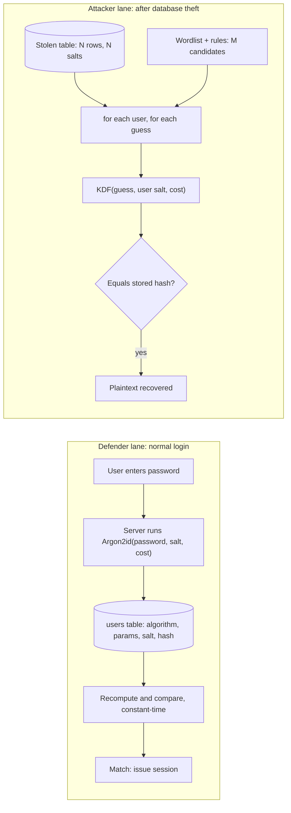

# Day 5: Hashing and password cracking

## Warm-up recall

Two minutes. Answer from memory first, then reveal. The question comes from yesterday (Day 4). Day 4 is the only earlier lesson so far that falls in range, so there is no second question today.

Q-A (Day 4): In a TLS connection, what job does public-key crypto do, what job does symmetric crypto do, and why not use one for everything?

<details>
<summary>Show answer</summary>

Public-key crypto (key exchange, signatures) lets two parties with no shared secret agree on one, and lets the server prove its identity. It is slow and has size limits. Symmetric crypto (AES-GCM, ChaCha20-Poly1305) encrypts the bulk traffic quickly once both sides hold the same session key. Hybrid design: asymmetric to set up the key, symmetric to move the data.

Link to today: both worlds use a one-way or key-derivation step. A hash has no key and cannot be reversed, which is the property password storage needs.

</details>

## Threat feed

Checked 2026-10-26. Four items I could open and verify. The CISA SafePay advisory (AA26-293A) was mentioned in an aggregator, but CISA's page would not load for me, so I left it out.

`CRIT` `KEV`

### Two more actively exploited flaws land in CISA KEV: Collabora CODE (RCE) and Arista VeloCloud Orchestrator (SQLi)

*Oct 23-24, 2026 | The Hacker News | [thehackernews.com](https://thehackernews.com/2026/10/cisa-flags-two-actively-exploited.html)*

CVE-2026-110447 (CVSS 9.2) is OS command injection reachable through `proxy.php` in the Collabora Online built-in CODE server used with Nextcloud. Attackers planted web shells and then searched for credential stores, password-manager artifacts and crypto wallets. CVE-2026-114625 (CVSS 9.9) is a SQL injection in on-prem Arista VeloCloud Orchestrator, the third VCO flaw exploited since July. It needs an authenticated session, but the lowest role (Enterprise Read Only) is enough. Federal deadline was Oct 26.

**TECHNICAL TAKEAWAY** Post-exploitation goes straight for stored secrets, which is why how your credential store hashes things matters. Authenticated is not the same as safe: "read only" roles still reached a SQL injection sink. Class: command injection and SQL injection (the article lists no CWE). `previews Day 8`

`CRIT` `NEW`

### LiteLLM 1.107.0 on PyPI shipped a credential stealer that runs every time Python starts

*Oct 23, 2026 | Microsoft Security Blog | [microsoft.com](https://www.microsoft.com/en-us/security/blog/2026/10/23/inside-the-litellm-1-107-0-supply-chain-compromise-credential-theft-through-python-startup-hooks/)*

Microsoft analyzed release 1.107.0 (published Oct 21). The wheel dropped `cook.pth`, `cook.py` and `sitecustomize.py` into site-packages. A `.pth` line beginning with `import` executes at interpreter startup, so the payload ran even if LiteLLM was never imported. It tried to read cloud configs, SSH keys, dotenv files, Kubernetes service-account files and environment variables, then POSTed an AES-encrypted bundle out. Maintainers say stolen developer GitHub credentials let attackers redirect the release workflow.

**TECHNICAL TAKEAWAY** Secrets that must be replayed (API keys, tokens) cannot be hashed like passwords, so they sit in files and env vars where stealers look. Mapped by Microsoft to T1195.001, T1546.018 (Python Startup Hooks) and T1552.001. `preview: supply chain and key management lessons`

`WARN`

### Crime Stoppers tips exposed through a third-party tip-management platform

*Oct 23, 2026 | Malwarebytes Labs | [malwarebytes.com](https://www.malwarebytes.com/blog/data-breaches/2026/10/crime-stoppers-chapter-freezes-tips-after-breach-breaks-anonymity-promise)*

A March 2026 breach of P3 Global Intel (a Navigate360 product) exposed original tip submissions. A CBC investigation reported over 1.5 million Canadian tips from 25 years, with more than 850,000 holding personal information such as addresses, phones and some banking details. Toronto Crime Stoppers paused tip intake by phone, web and app.

**TECHNICAL TAKEAWAY** The anonymity promise depended on a vendor's pipeline stripping identifiers before storage. When stripping happens after the data is collected, the raw data is the breach. Data minimization at the point of collection beats scrubbing later.

**GRC ANGLE** Vendor risk: does the vendor retain raw submissions, and does your contract cap retention and require breach notice? It took about seven months from breach to public impact reporting here, so ask about detection and notification SLAs, and map to SOC 2 CC9.2 (vendor management).

`INFO`

### Rapid7: treat AI agents like privileged insiders, with controls outside the model

*Oct 19, updated Oct 20, 2026 (a little older than the 3-5 day window) | Rapid7 | [rapid7.com](https://www.rapid7.com/blog/post/ai-inhuman-insider-threats-securing-agents)*

The post argues an agent's safety cannot rest on its own instructions. It recommends a separate scoped identity per agent, action-level least privilege with human approval for high-impact actions, tamper-evident logging of every tool call, an external kill switch, and treating persistent memory as a poisoning risk.

**TECHNICAL TAKEAWAY** Same principle as password storage: do not trust the component to protect itself, assume the secret or the model will be exposed and design so that exposure is survivable. `preview: AI security lesson`

## The idea

**A password hash is a deliberately slow, one-way fingerprint of the password, mixed with a unique random salt, so a stolen database forces the attacker to guess one password at a time, per user, at a cost you chose.**

> **ANALOGY**Think of a blender that costs the attacker 0.1 seconds per smoothie. Login: you blend your own fruit once and compare the result. Breach: the thief has the blended results only, and must try millions of fruit guesses, one blender run each. Salt means every user has a different blender, so a pre-computed table of smoothies is useless. Slowness is the price of each guess.

## Why it matters

**LinkedIn, 2012 breach, public in 2016.** The stolen database stored passwords as *unsalted SHA-1*. When the data surfaced in 2016, about 117 million email and password-hash pairs were in circulation, and per Motherboard (as reported by TechCrunch) roughly 90 percent of the passwords were cracked within 72 hours. SHA-1 is fast, with no per-user salt, so one guess tested against every account at once.

[TechCrunch, May 2016](https://techcrunch.com/2016/05/18/117-million-linkedin-emails-and-passwords-from-a-2012-hack-just-got-posted-online)

## How it works

1. **Register.** Server generates a random salt (16 bytes from a CSPRNG), runs `KDF(password, salt, cost)`, and stores one self-describing string.
2. **Store.** The DB row holds algorithm, parameters, salt and hash together. Nothing secret is needed to verify.
3. **Login.** Read the row, recompute with the same salt and parameters, compare in constant time.
4. **Breach.** Attacker dumps the table. Hashes cannot be reversed, so he guesses: hash each candidate with *that user's* salt and parameters and compare.
5. **Economics.** Cost is attempts times time per attempt. A fast hash makes billions of guesses per second possible on GPUs. Memory-hard KDFs make each guess consume RAM, which blunts GPU parallelism.



*The same function is cheap once per login and expensive when repeated N x M times by an attacker. Unsalted fast hashes remove both multipliers.*

```text
# id,username,password_field
1,alice,$argon2id$v=19$m=19456,t=2,p=1$<22-char base64 salt>$<43-char base64 hash>
2,bob,8d6e34f987851aa599257d3831a1af040886842f   # bare unsalted SHA-1: grep it, look it up
```

> **ATTACKER SEES**A string. If bare hex, the length tells the algorithm (40 hex = SHA-1, 64 = SHA-256). If a `$id$` format, the prefix names the algorithm and cost, and tells him how expensive each guess is.

> **DEFENDER SEES**Login latency (~100 to 500 ms is intended), CPU/RAM spikes during login bursts, and a credential-stuffing signature: many users, few attempts each, one source.

## Common misconceptions

- **"SHA-256 is strong, so SHA-256 is fine."** Strong for integrity, wrong for passwords. Its speed is the flaw: a single desktop CPU thread did over a million SHA-256 hashes a second in the lab below, and GPUs do far more. Password hashing wants *slow* and *memory-hard*.
- **"The salt must be secret."** No. It is stored next to the hash. Its job is uniqueness: it kills rainbow tables and stops one guess from hitting all users. A *pepper* is the secret one, kept outside the DB (vault/HSM), as defense in depth only.
- **"Hashing and encrypting are the same thing."** Encryption is reversible with a key, so a key leak exposes every password. A hash has no decrypt operation, so the attacker has to guess.
- **"bcrypt handles any length."** Most implementations use only the first 72 bytes. OWASP says to cap at 72 bytes or less, or pre-hash carefully.

## Attacker abuse

`T1110.002 Password Cracking` `T1110.003 Password Spraying` `CWE-916 Insufficient Computational Effort` `CWE-759 Unsalted One-Way Hash`

- **Dictionary + rules.** Wordlist ("sunshine") plus mutations (capitalize, append 2-digit year, leetspeak). Humans are predictable, so rules beat brute force.
- **Lookup/rainbow tables.** Pre-computed hash to password maps. Work only against unsalted or constant-salt hashes. This is the LinkedIn failure mode.
- **GPU brute force.** Throughput scales with hash speed. Memory-hard functions such as Argon2id and scrypt reduce that advantage.
- **Spraying and stuffing against live endpoints** (no stolen DB needed): one common password across many accounts, or reused breached credentials. Rate limiting and MFA defend here, not hashing.

IDs checked: [ATT&CK T1110.002](https://attack.mitre.org/techniques/T1110/002/), [CWE-916](https://cwe.mitre.org/data/definitions/916), [CWE-759](https://cwe.mitre.org/data/definitions/759).

## Defender playbook

### Prevent

Use Argon2id first. OWASP's equal-strength minimums (memory, iterations, parallelism):

| Algorithm | OWASP minimum / guidance |
|---|---|
| Argon2id | m=19456 KiB (19 MiB), t=2, p=1 (also m=47104,t=1 or m=12288,t=3 or m=9216,t=4 or m=7168,t=5) |
| scrypt | N=2^17, r=8, p=1 (or N=2^16,p=2; N=2^15,p=3) |
| bcrypt (legacy) | work factor 10 or more; 72-byte input limit |
| PBKDF2-HMAC-SHA256 | 600,000 iterations (FIPS-validated needs) |

- **Rehash on login.** When a user authenticates with an old hash, verify, then store the new scheme. Migrates without forced resets.
- **Check new passwords against breached-password lists** and don't force composition rules (NIST SP 800-63B direction). Offer MFA, preferably phishing-resistant.
- **Pepper** via HMAC with a key held in a vault/HSM, as extra depth only.
- **Throttle** login attempts per account and per source, with alerting.

### Detect

```text
10:02:11 FAIL user=a.kim   src=203.0.113.45 reason=bad_password
10:02:12 FAIL user=b.shah  src=203.0.113.45 reason=bad_password
10:02:13 FAIL user=c.diaz  src=203.0.113.45 reason=bad_password
# 1 source, many users, 1 try each = spraying, not a typo
```

```text
title: Possible password spraying (many accounts, one source)
logsource: {category: authentication}
detection:
  selection: {outcome: failure}
  condition: selection | count(user) by src_ip > 10   # window: 10m, tune to baseline
tags: [attack.credential_access, attack.t1110.003]
falsepositives: [shared NAT, SSO misconfig loops]
```

Also alert on: a sudden bulk read of the credentials table, and DB dumps leaving the network. Those are your window to force resets before cracking finishes.

## Hands-on lab (optional)

Optional, 20 min. Local only, using hashes you generate yourself. Needs Python 3.

```python
import hashlib, os, time

# Part 1: unsalted SHA-1 falls to a lookup table instantly
wordlist = ["password", "123456", "letmein", "dragon", "sunshine", "hunter2"]
table = {hashlib.sha1(w.encode()).hexdigest(): w for w in wordlist}
leaked = hashlib.sha1(b"sunshine").hexdigest()
print("leaked:", leaked, "->", table.get(leaked))

# Part 2: a per-user salt breaks the shared table
def salted(pw, salt): return hashlib.sha256(salt + pw.encode()).hexdigest()
s1, s2 = os.urandom(16), os.urandom(16)
print("same pw, different salts equal?", salted("sunshine", s1) == salted("sunshine", s2))

# Part 3: cost. Fast hash vs slow KDFs
def bench(label, fn, n):
    t = time.perf_counter()
    for _ in range(n): fn()
    dt = (time.perf_counter() - t) / n
    print(f"{label:<28}{dt*1000:10.3f} ms/guess  ~{1/dt:12,.0f} guesses/s (1 thread)")

salt = os.urandom(16)
bench("sha256", lambda: hashlib.sha256(b"sunshine").digest(), 200000)
bench("pbkdf2-sha256 600k", lambda: hashlib.pbkdf2_hmac("sha256", b"sunshine", salt, 600_000), 3)
bench("scrypt N=2^15 r=8 p=1", lambda: hashlib.scrypt(b"sunshine", salt=salt, n=2**15, r=8, p=1, maxmem=64*1024*1024), 3)
```

```bash
python3 lab.py
```

**Look for:** Part 1 prints `sunshine` for the leaked hash. Part 2 prints `False`. Part 3: when this was run on a cloud container, SHA-256 managed over a million guesses/s on one thread, PBKDF2 at 600k iterations about 2/s, scrypt (N=2^15) about 8/s. Your numbers differ, but the ratio of roughly five to six orders of magnitude is the lesson.

> **STRETCH**Install hashcat or John the Ripper on your own machine, generate 20 hashes of your own throwaway passwords with `hashlib`, and crack them with a small wordlist (hashcat mode `-m 100` is SHA-1). Compare to bcrypt (`-m 3200`) and note the speed drop. Only ever do this on hashes you created.

**Free practice:** TryHackMe [Hashing - Crypto 101](https://tryhackme.com/room/hashingcrypto101) and [Crack the Hash](https://tryhackme.com/room/crackthehash) (both appear in TryHackMe's free room lists; availability can change).

## Portfolio idea

**hash-audit:** a Python CLI that reads a user table export, classifies each hash by format (bare MD5/SHA-1/SHA-256, bcrypt, argon2id) and cost parameters, and reports a risk score against the OWASP minimums above. Add a "rehash on login" demo with Flask. Ship it with tests and a README showing before/after benchmarks.

## Teach it back

Explain this to a non-technical colleague in 3 sentences. Write yours first.

<details>
<summary>Show answer</summary>

"We never keep your actual password, only a scrambled fingerprint that can't be turned back. Each fingerprint is made with a unique random ingredient and is deliberately slow to produce, so a thief who steals our database has to guess passwords one at a time and pay that time cost for every guess. That's why good storage turns a stolen file from an instant disaster into months of work, and why a unique, hard-to-guess password still matters."

</details>

## Self-check

1 (recall). Name two jobs a salt does and one thing it does *not* do.

<details>
<summary>Show answer</summary>

It makes identical passwords hash differently, which defeats rainbow/lookup tables, and it forces the attacker to attack each user separately. It does not slow a single guess and it is not secret, so it does not protect a weak password from a targeted dictionary attack.

</details>

2 (application). Your DB uses bcrypt cost 10 and a developer proposes switching to `sha256(salt + pw)` "because it's faster at login". What is wrong with that?

<details>
<summary>Show answer</summary>

Faster for you means faster for the attacker, by the same factor, multiplied across GPUs. The salt still blocks tables, but each guess is nearly free. That is CWE-916 (insufficient computational effort). Keep a slow KDF, and tune cost to roughly your acceptable login latency.

</details>

3 (scenario). Monday 09:10, your SIEM shows a 40 GB export from the production `users` table to an unknown external IP. Hashes are Argon2id at OWASP minimums, plus some legacy unsalted SHA-1 rows from a 2014 import. What do you do?

<details>
<summary>Show answer</summary>

Declare an incident and contain: block the egress path, preserve logs, revoke the compromised credential/session that did the export. Then prioritize: the legacy SHA-1 rows are effectively plaintext, so force resets for those users first and assume credential stuffing against other services. Force resets for everyone (Argon2id buys time, not immunity), rotate any pepper (which needs resets too), invalidate sessions/tokens, and notify per your breach obligations and contracts (GRC and legal early).

Follow-up: remove the legacy rows by rehash-on-login or forced reset, and add alerts on bulk reads of credential tables.

</details>

## Go deeper

- [OWASP Password Storage Cheat Sheet](https://cheatsheetseries.owasp.org/cheatsheets/Password_Storage_Cheat_Sheet.html) (parameters, peppering, migration)
- [NIST SP 800-63B-4: Authenticators](https://pages.nist.gov/800-63-4/sp800-63b/authenticators) (password verifier requirements)
- [MITRE ATT&CK T1110.002: Password Cracking](https://attack.mitre.org/techniques/T1110/002/)

**Where this shows up in your work:** NIST 800-53 IA-5 (authenticator management) and SC-28 (protection of information at rest), and SOC 2 CC6.1 (logical access); auditors may ask how credentials are hashed and whether you screen for breached passwords.

**Certification objectives:** Security+ (cryptographic concepts: hashing, salting, key stretching; password attacks), CySA+ (indicators of credential attacks), Pentest+ (password cracking tools and attacks).


See you tomorrow: **Day 6, HTTP fundamentals, cookies, and sessions**. Today's hashes are tomorrow's session tokens.

**Sources**

- [The Hacker News: CISA flags two actively exploited critical flaws](https://thehackernews.com/2026/10/cisa-flags-two-actively-exploited.html)
- [Microsoft Security Blog: LiteLLM 1.107.0 compromise](https://www.microsoft.com/en-us/security/blog/2026/10/23/inside-the-litellm-1-107-0-supply-chain-compromise-credential-theft-through-python-startup-hooks/)
- [Malwarebytes: Crime Stoppers chapter freezes tips](https://www.malwarebytes.com/blog/data-breaches/2026/10/crime-stoppers-chapter-freezes-tips-after-breach-breaks-anonymity-promise)
- [Rapid7: AI agents as insider threats](https://www.rapid7.com/blog/post/ai-inhuman-insider-threats-securing-agents)
- [TechCrunch: LinkedIn 2012 breach data posted](https://techcrunch.com/2016/05/18/117-million-linkedin-emails-and-passwords-from-a-2012-hack-just-got-posted-online)
