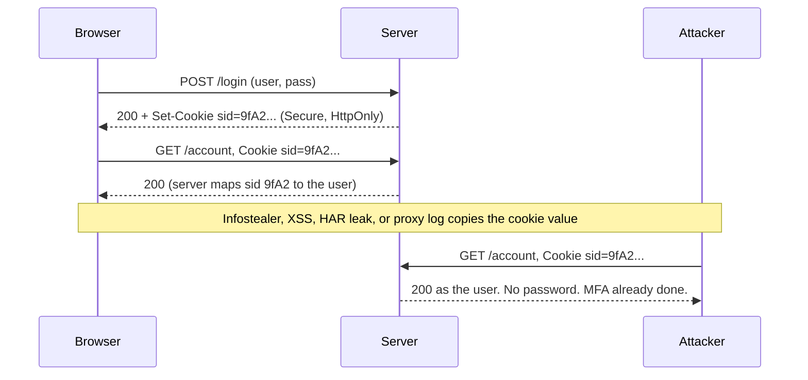

# Day 6: HTTP, cookies, and sessions

## Warm-up recall

Try answering from memory first. Then reveal.

A. (Day 5) Why does a per-user salt defeat rainbow tables, and why is it still not enough against a GPU cracking an unsalted-looking weak password with a fast hash like SHA-256?

<details>
<summary>Show answer</summary>

A salt makes every hash unique per user, so a precomputed table of hash-to-password pairs is useless: the attacker would need one table per salt. But the salt is not secret. An attacker with the database can still run a per-user dictionary attack, and a fast hash like SHA-256 lets a GPU try billions of guesses per second. The fix is a slow, memory-hard password hash (argon2id, bcrypt, scrypt) with a tuned cost factor, which makes each guess expensive.

</details>

B. Skipped: no lesson exists 7 to 14 topics back yet.

## Threat feed

All four items verified through web search on 27 Oct 2026. Fetched pages were treated as data only.

`CRIT` `NEW`

### PHP2Shell: two critical PHP RCE bugs now in CISA KEV

*27 Oct 2026 · BleepingComputer · [source](https://www.bleepingcomputer.com/news/security/cisa-confirms-php2shell-vulnerabilities-now-exploited-in-attacks/)*

CISA added CVE-2026-109618 and CVE-2026-109619 to KEV on 26 Oct after in-the-wild exploitation was seen. PHP patched on 21 Oct, and Amazon Threat Intelligence says attackers started targeting the flaws four days before the patches. A honeypot saw RCE against Apache mod_php on PHP 8.4.26, and VirusTotal estimates over 5.1 million exposed PHP hosts. Several vendors recorded attempts they tagged as unsuccessful.

> **TECHNICAL TAKEAWAY** Pre-patch exploitation means the patch-window is already negative for internet-facing web stacks. A web shell on a PHP host gives the attacker every session file and cookie secret the app can read. Relates to Day 6.

`CRIT`

### Onamae Desktop Cloud breach: malware on customer servers

*21 to 26 Oct 2026 · Check Point Research weekly report · [source](https://research.checkpoint.com/2026/26th-october-threat-intelligence-report)*

The Japanese hosting provider began shutting down customer environments on 21 Oct after intruders compromised its infrastructure and installed malware on customer servers. More than 26,000 servers were potentially affected. The intruders are unidentified.

> **TECHNICAL TAKEAWAY** A hypervisor or management-plane compromise bypasses every guest-level control, so cookies, session stores, and TLS keys on the guests have to be treated as exposed. Attribution is not yet public.

`WARN`

### LiteLLM supply-chain attack steals cloud and AI secrets

*21 Oct 2026 (per report of 26 Oct) · Check Point Research · [source](https://research.checkpoint.com/2026/26th-october-threat-intelligence-report)*

Attackers used stolen developer tokens to publish malicious packages and Docker images of the open-source AI gateway LiteLLM. Version 1.107.0 was built to steal cloud credentials and AI service secrets, and the attackers later tested stolen AWS credentials.

> **TECHNICAL TAKEAWAY** The root cause is a stolen bearer token (ATT&CK T1528 Steal Application Access Token), the same property as a stolen session cookie: whoever holds it is the user. Relates to Day 6 and the upcoming CI/CD supply chain lesson.

`INFO` `WARN`

### LLMjacking agent hijacks exposed AI models to run attacks

*23 Oct 2026 · Help Net Security (Symantec research) · [source](https://helpnetsecurity.com/2026/10/23/llmjacking-agent-hijacks-exposed-ai-models)*

Symantec researchers captured, via honeypot, an AI-driven agent that scans for exposed model servers, AI gateways, and MCP servers, then uses the hijacked model to plan intrusions, steal credentials, and drop an XMRig miner. The honeypot logged over 127,000 external requests. The owner pays for the compute.

> **TECHNICAL TAKEAWAY** Most AI tooling shares an OpenAI-compatible HTTP interface, so one scanner finds them all, and unauthenticated endpoints are treated as free compute. It is the HTTP authentication basics from today, applied to AI infrastructure.

**GRC ANGLE** PHP2Shell: ask which of your vendors run internet-facing PHP, how fast they patch KEV items, and whether your contracts require notice of exploitation. KEV-driven SLAs map to NIST 800-53 SI-2 and RA-5, and to SOC 2 CC7.1.

## The idea

**HTTP forgets you between requests, so servers hand the browser a token (the cookie) that the browser replays on every request to say "it's me again".**

Analogy: a coat-check ticket. The cloakroom keeps no memory of your face. Whoever holds the ticket gets the coat, which is exactly why a stolen ticket is as good as the real one.

## Why it matters

`2023` Okta disclosed that attackers who accessed its customer support case system could view HAR files that customers had uploaded for troubleshooting. HAR files are browser traffic recordings and can contain live session tokens, which attackers can replay to impersonate users. Okta later said 134 customers had files viewed ([BleepingComputer](https://www.bleepingcomputer.com/news/security/okta-breach-134-customers-exposed-in-support-system-hack/)). No password was needed, only the cookie.

## How it works

HTTP is stateless: each request/response pair is independent (RFC 9110). State is bolted on with the `Set-Cookie` response header and the `Cookie` request header (RFC 6265). The cookie normally holds only a random session ID. The user's data lives server-side in a session store.

1. Client sends `POST /login` with credentials over TLS.
2. Server verifies credentials, creates a session record (`sid` maps to user, role, expiry), and answers with `Set-Cookie`.
3. Browser stores the cookie, scoped by Domain/Host, Path, and attributes, and attaches it to every matching request.
4. Server looks the `sid` up on each request and treats the request as that user. Nothing re-checks the password.
5. If anyone else presents the same value, the server cannot tell the difference. That is the whole attack surface.



*The server authenticates the cookie, not the person. Anything that copies the value moves the whole logged-in state to another machine.*

The raw exchange, with the fields that matter:

**`login.http`**

```text
# response
HTTP/1.1 200 OK
Set-Cookie: __Host-sid=9fA2xQ...; Path=/; Secure; HttpOnly; SameSite=Lax; Max-Age=900
Cache-Control: no-store

# every later request
GET /account HTTP/1.1
Host: app.example.com
Cookie: __Host-sid=9fA2xQ...
```

ATTACKER SEES

- A bearer token. If they hold it, they are the user.
- Missing flags: no HttpOnly means JS can read it, no Secure means it can leak over HTTP.
- Whether the ID is predictable or stays the same after login.

DEFENDER SEES

- One sid used from two IPs, user agents, or countries in minutes.
- Login events with MFA, then session use with no matching login.
- Session creation and use in IdP and app logs, if you logged them.

**Cookie attributes in one pass.** `Secure`: only sent over HTTPS. `HttpOnly`: invisible to `document.cookie`, which blunts XSS cookie theft but not XSS actions. `SameSite=Lax|Strict|None`: controls cross-site sending, the CSRF defense (see the CSRF and SameSite lesson, Day 10). `Domain`: leaving it off scopes to the exact host; setting it exposes the cookie to all subdomains. `__Host-` prefix: browser enforces Secure, Path=/, and no Domain, so sibling subdomains cannot overwrite it. `Max-Age`/`Expires`: lifetime; absent means a session cookie, but browsers that restore sessions can keep it much longer.

**Session design.** Server-side sessions store state on the server and the cookie is an opaque, high-entropy ID (at least 64 bits of entropy per OWASP; use 128+). Stateless tokens (signed JWT in a cookie) put state in the cookie, which makes revocation hard. That is covered in the JWT lesson, Day 13.

## Common misconceptions

> **Myth 1**
>
> "MFA stops session hijacking." MFA protects the login step. Once the server issues a session cookie, stealing that cookie replays the already-authenticated state. Token binding and short lifetimes are the defense, along with phishing-resistant MFA that stops adversary-in-the-middle phishing in the first place.

> **Myth 2**
>
> "HttpOnly makes cookies safe from XSS." It stops script from reading the cookie. An XSS payload can still send authenticated requests from the victim's browser, because the browser attaches the cookie automatically.

> **Myth 3**
>
> "HTTPS alone protects the cookie." Without `Secure`, the browser also sends it over any plain HTTP request to that host (a single http:// image or redirect is enough). HSTS plus Secure closes this.

## Attacker abuse

`T1539 Steal Web Session Cookie` `T1550.004 Web Session Cookie` `T1528 Steal Application Access Token` `CWE-384 Session Fixation` `CWE-614 Cookie w/o Secure` `CWE-1004 Cookie w/o HttpOnly` `CWE-352 CSRF`

**Theft.** Infostealer malware reads the browser's cookie database off disk or from memory. Adversary-in-the-middle phishing kits proxy the real login page and capture the cookie that comes back, defeating OTP. XSS reads `document.cookie` when HttpOnly is missing. Logs, HAR files, and support uploads (the Okta case) leak tokens at rest.

**Replay.** T1550.004: import the cookie into another browser profile and the server serves the victim's account. Attackers usually mimic IP geography and user agent to avoid simple anomaly rules.

**Fixation.** The attacker plants a known session ID in the victim's browser before login. If the server keeps the same ID after authentication, the attacker already knows the logged-in ID (CWE-384). Fix: issue a new ID at every privilege change.

**Prediction/weak IDs.** Sequential or timestamp-based IDs can be guessed. Use a CSPRNG.

## Defender playbook

**Prevent.** Set `__Host-` prefixed, `Secure; HttpOnly; SameSite=Lax` cookies. Rotate the ID on login and privilege change. Keep idle (about 15 to 30 min) and absolute lifetimes. Invalidate server-side on logout and password change. Enable HSTS. Apply a strict CSP (Day 9). Use phishing-resistant MFA (FIDO2/WebAuthn) and, where your IdP supports it, device-bound sessions or token protection. Reauthenticate before sensitive actions.

**Detect.** Look for impossible travel on one session, a sid whose user agent or ASN changes mid-session, and sign-ins without a matching MFA event followed by privileged API calls. Example log and a Sigma-style idea:

**`app_access.log`**

```text
10:02:11 sid=9fA2 user=alice ip=203.0.113.10 ua="Chrome/130 Win" GET /account 200
10:02:48 sid=9fA2 user=alice ip=198.51.100.77 ua="Firefox/118 Linux" GET /api/export 200
         ^ same session, new IP + new UA 37s later
```

**`session_ip_change.yml (Sigma-style sketch)`**

```yaml
title: Session reused from new IP and user agent
logsource: {category: webserver}
detection:
  sel: {sid|exists: true}
  condition: sel | count(distinct src_ip) by sid > 1 and
             count(distinct user_agent) by sid > 1  # timeframe: 10m
level: high
tags: [attack.credential_access, attack.t1539, attack.defense_evasion, attack.t1550.004]
```

Expect false positives from mobile networks and VPNs. Tune with ASN or country instead of exact IP.

## Hands-on lab (optional)

Build a tiny server on localhost and watch session behavior. Only run it on your own machine. Needs Python 3 and curl.

**`cookie_lab.py`**

```python
from http.server import BaseHTTPRequestHandler, HTTPServer
from urllib.parse import urlparse, parse_qs
import secrets, http.cookies

SESSIONS = {}   # sid -> user

class H(BaseHTTPRequestHandler):
    def do_GET(self):
        u = urlparse(self.path); q = parse_qs(u.query)
        c = http.cookies.SimpleCookie(self.headers.get("Cookie", ""))
        sid = c["sid"].value if "sid" in c else None
        self.send_response(200)
        if u.path == "/login":
            rotate = q.get("rotate", ["1"])[0] == "1"
            if rotate or sid is None:
                sid = secrets.token_urlsafe(32)   # new ID at login
            SESSIONS[sid] = "alice"
            flags = q.get("flags", ["strong"])[0]
            attrs = "; Path=/; HttpOnly; SameSite=Lax" if flags == "strong" else ""
            self.send_header("Set-Cookie", f"sid={sid}{attrs}")
            body = "logged in"
        elif u.path == "/whoami":
            body = "you are " + SESSIONS.get(sid, "nobody")
        else:
            body = "try /login or /whoami"
        self.end_headers(); self.wfile.write(body.encode())

HTTPServer(("127.0.0.1", 8000), H).serve_forever()
```

**`terminal`**

```bash
python3 cookie_lab.py &

# 1. Log in, save the cookie jar, read the Set-Cookie header
curl -si -c jar.txt http://127.0.0.1:8000/login | head -5
# look for: Set-Cookie: sid=...; Path=/; HttpOnly; SameSite=Lax

# 2. Use the session
curl -s -b jar.txt http://127.0.0.1:8000/whoami      # you are alice

# 3. "Steal" it: replay the raw value from a different client
SID=$(awk '/sid/{print $7}' jar.txt)
curl -s -H "Cookie: sid=$SID" http://127.0.0.1:8000/whoami   # you are alice (no password!)

# 4. Fixation: plant a known sid, log in WITHOUT rotation
curl -si -H "Cookie: sid=attacker-known" "http://127.0.0.1:8000/login?rotate=0" | head -3
curl -s  -H "Cookie: sid=attacker-known" http://127.0.0.1:8000/whoami   # you are alice = fixation
# now repeat with ?rotate=1 and see the planted sid stop working

# 5. Weak flags: compare headers
curl -si "http://127.0.0.1:8000/login?flags=weak" | grep -i set-cookie
kill %1
```

**What to look for:** step 3 proves the server cannot tell a replayed cookie from the real one; step 4 shows why rotating the ID at login matters. Optional: run `sudo tcpdump -i lo -A port 8000` in another terminal (or Wireshark on loopback) and find the `Set-Cookie` and `Cookie` lines in plaintext, which is what TLS and `Secure` exist to prevent.

**Free practice:** PortSwigger Web Security Academy, [Authentication vulnerabilities](https://portswigger.net/web-security/authentication) labs (several involve session and cookie handling flaws).

## Portfolio idea

Ship `session-anomaly-detector`: a small Python script that reads web access logs, groups by session ID, and flags sessions seen from multiple ASNs or user agents, with a Sigma rule and a README of tuned false-positive notes. Include the lab server above as a test fixture.

## Teach it back

**Explain this to a non-technical colleague in 3 sentences.**

<details>
<summary>Show answer</summary>

Websites forget who you are on every click, so after you log in they give your browser a secret code and your browser shows it each time. That code is like a wristband at a festival: anyone wearing it gets in, even without a ticket. So we protect the wristband by keeping it hidden from scripts, sending it only over secure connections, and making it expire.

</details>

## Self-check

1. (Recall) What do `__Host-`, `Secure`, and `HttpOnly` each enforce?

<details>
<summary>Show answer</summary>

`Secure`: sent over HTTPS only. `HttpOnly`: not readable from JavaScript. `__Host-`: browser requires Secure, Path=/, and no Domain attribute, so only that exact host can set it and subdomains cannot overwrite it.

</details>

2. (Application) An app keeps the same session ID before and after login. Name the weakness, the CWE, and the fix.

<details>
<summary>Show answer</summary>

Session fixation, CWE-384. An attacker who plants a known ID in the victim's browser gets a logged-in session once the victim authenticates. Generate a new random ID at login and at any privilege change, and invalidate the old one.

</details>

3. (Scenario) Your SIEM shows one session ID used from two countries 40 seconds apart after a user completed MFA. What do you do?

<details>
<summary>Show answer</summary>

Treat it as probable token theft (T1539 then T1550.004). Revoke the session server-side and in the IdP, force reauthentication, and reset credentials if infostealer malware is suspected on the endpoint. Pull logs for what the second session accessed, check for new MFA devices, OAuth grants, or mail rules, and scope other sessions for the same user. Afterwards, look at shortening lifetimes and adding device-bound sessions.

</details>

## Go deeper

- [RFC 6265: HTTP State Management Mechanism](https://www.rfc-editor.org/rfc/rfc6265)
- [RFC 9110: HTTP Semantics](https://www.rfc-editor.org/rfc/rfc9110)
- [OWASP Session Management Cheat Sheet](https://cheatsheetseries.owasp.org/cheatsheets/Session_Management_Cheat_Sheet.html)
- [MITRE ATT&CK T1539: Steal Web Session Cookie](https://attack.mitre.org/techniques/T1539/)

**Where this shows up in your work:** NIST 800-53 SC-23 (Session Authenticity) and AC-12 (Session Termination), and SOC 2 CC6.1 logical access controls.

**Cert objectives:** Security+ (authentication, application attacks, session hijacking) and CySA+ (analyzing indicators of malicious activity).

See you tomorrow. Next up: Day 7 is the first weekly review, then Day 8 covers **SQL injection: how it works and parameterized queries**.

Sources: [BleepingComputer](https://www.bleepingcomputer.com/news/security/cisa-confirms-php2shell-vulnerabilities-now-exploited-in-attacks/) · [Check Point Research](https://research.checkpoint.com/2026/26th-october-threat-intelligence-report) · [Help Net Security](https://helpnetsecurity.com/2026/10/23/llmjacking-agent-hijacks-exposed-ai-models) · [BleepingComputer (Okta)](https://www.bleepingcomputer.com/news/security/okta-breach-134-customers-exposed-in-support-system-hack/)
