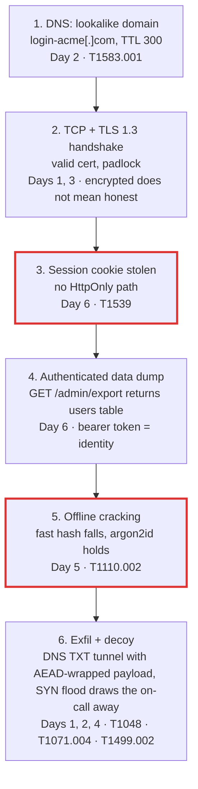

# Day 7: Weekly review: week 1

## Warm-up recall

This is a review day, so there is no new topic. Work top to bottom: skim the recaps, read the feed, trace the attack chain, then close the page and answer the quiz from memory before opening any answer. Retrieval is what makes it stick.

## Week recap

### Day 1 · TCP/IP and SYN floods

The handshake is SYN, SYN-ACK, ACK. After the SYN the server allocates a half-open entry in its backlog and waits. A SYN flood sends SYNs (often from spoofed sources) and never completes, so the backlog fills and real clients are refused. SYN cookies defeat this by encoding connection state into the server's initial sequence number, so nothing is stored until a valid ACK returns.

### Day 2 · DNS and its attacks

A stub resolver asks a recursive resolver, which walks root, TLD and authoritative servers and caches answers for the TTL. Poisoning means winning a race to inject a forged answer: the attacker must match the 16-bit transaction ID and, ideally, the UDP source port, which is why port randomization and DNSSEC matter. Tunneling hides data in query labels (63 bytes per label, 253 per name) and TXT answers; you spot it by length, entropy and volume per domain.

### Day 3 · TLS 1.3 handshake

One round trip. ClientHello carries `supported_versions`, `key_share` and signature algorithms. ServerHello answers with its own key share, both sides derive handshake keys through HKDF, and everything after that is encrypted: EncryptedExtensions, Certificate, CertificateVerify, Finished. Ephemeral (EC)DHE is mandatory, which gives forward secrecy. 0-RTT early data is replayable and needs care.

### Day 4 · Public-key vs symmetric crypto

Asymmetric crypto solves key agreement and authentication but is slow and size-limited. Symmetric AEAD ciphers (AES-GCM, ChaCha20-Poly1305) are fast and protect bulk data. Systems combine them: use asymmetric math to agree on or wrap a key, then use that key symmetrically. Envelope encryption in a KMS is the same pattern at rest.

### Day 5 · Hashing, salting, cracking

Fast hashes like MD5 and SHA-256 are built for speed, which is exactly what a cracker wants. A per-user salt kills rainbow tables and shared-hash lookups but does not slow a targeted guess. bcrypt adds a tunable cost factor (and truncates input at 72 bytes); argon2id adds memory hardness so GPUs lose their advantage. A pepper held outside the database adds a second barrier.

### Day 6 · HTTP, cookies, sessions

HTTP is stateless, so a session is a bearer token in a `Cookie` header that the server maps to state. Whoever presents the token is the user. The attributes carry the defense: `Secure` (never over plaintext), `HttpOnly` (invisible to JavaScript), `SameSite` (limits cross-site sending), plus sane `Path`, `Domain` and expiry. Rotate the ID on login to block fixation.

## Threat feed

Four items verified against the linked sources on Oct 28, 2026. Two come from vendor or victim write-ups; the KEV detail is from a secondary outlet and flagged below.

`[CRIT]` `[NEW]`

### PHP2Shell: two memory-safety bugs in PHP give unauthenticated RCE

*Oct 21, 2026 (fix release) · Recorded Future Insikt Group · [source](https://www.recordedfuture.com/blog/php2shell-vulnerability-exploitation) · KEV listing reported Oct 28 by [Cyber Security News](https://cybersecuritynews.com/php2shell-vulnerabilities-actively-exploited/)*

PHP shipped an out-of-band release for CVE-2026-109618 and CVE-2026-109619 (both CVSS v4.0 9.2). Wiz demonstrated unauthenticated remote code execution against WordPress, Drupal and Joomla. Hosting partners reported active exploitation within hours, though the full extent of successful compromise is not established. The secondary report says CISA added both to KEV on Oct 26 with an Oct 29 federal deadline; confirm on the KEV page before citing it.

Fixed in PHP 8.2.35, 8.3.36, 8.4.27 and 8.5.12. Older unsupported branches get no fix.

**TECHNICAL TAKEAWAY** Both flaws are use-after-free style bugs (the CWE-416 class) in how PHP handles request memory after an out-of-memory error and stale globals. Wiz found a UAF in the session upload-progress unserializer. The request itself is just HTTP, which is why a WAF sees nothing odd. `T1190` `relates to Day 6`

`[WARN]`

### Railway: build-infrastructure escalation exposes customer secrets

*Oct 22, 2026 · Railway preliminary report · [source](https://blog.railway.com/p/preliminary-report-october-security-incident)*

An attacker was inside Railway systems from Oct 20 to Oct 22 (UTC). Railway cites "potential privilege escalation in our build infrastructure". The attacker queried encrypted environment variables and decrypted some using compromised credentials, apparently hunting AI provider API keys. Railway estimates at most 1.85% of workspaces (about 100,000) had variables potentially exposed and tells customers who signed up before Oct 21 to rotate their keys.

**TECHNICAL TAKEAWAY** Encryption at rest only helps if the decrypting identity is hard to reach. CI credentials that can decrypt artifacts sit on the attack path, so the build system became the key vault. The root cause is not yet published. `T1552` `relates to Day 4`

`[CRIT]`

### LiteLLM 1.107.0: a May key leak ends in a hijacked release pipeline

*Oct 23, 2026 · LiteLLM disclosure, reported by The Hacker News on Oct 24 · [source](https://thehackernews.com/2026/10/leaked-litellm-master-key-let-attackers.html)*

A master key committed to a public repo on May 27 was never revoked. On Oct 10 an attacker used it to pull an over-scoped GitHub OAuth token, pushed token-harvesting workflows, then on Oct 21 triggered and approved a release with two stolen tokens. Version 1.107.0 sat on PyPI for about 1 hour 45 minutes. It ran at Python startup, stole credentials, and installed a backdoor that polled hourly.

**TECHNICAL TAKEAWAY** A force-push does not un-leak a secret; only revocation does. Bearer tokens are only as safe as their scope and the approval rules around them. `T1195.002` `T1552.001` `relates to Day 5 and Day 6`

`[INFO]` `[NEW]`

### Hidden instructions for AI agents found across 86 million GitHub items

*Oct 27, 2026 · Radware research, reported by CybrSec Media · [source](https://www.cybrsecmedia.com/who-is-prompt-injecting-coding-agents-a-scan-of-86-million-github-items/)*

Radware scanned issues, pull requests, comments and READMEs for text aimed at AI agents. About 2.5 per 100,000 items carried an injection. Some were legitimate orchestration; some tried to steal data. The study measures intent, not how often attacks worked.

**TECHNICAL TAKEAWAY** Indirect prompt injection: HTML comments in Markdown are invisible when rendered but fully visible to an agent that reads the raw text. The agent treats untrusted content with the authority of its user. A preview of the AI security lesson.

> **GRC ANGLE** LiteLLM and Railway raise the same vendor-risk questions: do you know which third-party tools hold your credentials, can you rotate them within hours, and does your contract require breach notice and key-rotation guidance? Map to access and secrets controls (NIST 800-53 IA-5, SR-3) and SOC 2 vendor management (CC9.2).

## Connect the dots

One realistic story that uses all six topics. Read the diagram top to bottom; each box is something you learned this week.



*The chain: each stage reuses a mechanism from this week. Red borders mark the two cheapest places to break it: cookie flags and password hashing.*

> **DEFENDER VIEW** Break the chain early and cheaply: `HttpOnly; Secure; SameSite` cookies and short sessions at stage 3, argon2id at stage 5, and DNS query-length and entropy alerts at stage 6. Parallel: the LiteLLM and Railway stories above are the same shape, with stolen tokens instead of cookies.

## Self-check

Answer out loud or on paper first. No older weeks exist yet, so questions 7 and 8 are interleaved across topics and feed items instead.

**Q1** In a SYN flood, what exact resource is exhausted, and how do SYN cookies avoid storing anything?

<details>
<summary>Show answer</summary>

The half-open (SYN_RECV) backlog queue. With SYN cookies the server encodes a hash of the 4-tuple, a timestamp and the MSS into its initial sequence number, then rebuilds state only when the final ACK echoes that number plus one.

</details>

**Q2** A Kaminsky-style attacker wants to poison a resolver. What must the forged response match, and what raised the cost?

<details>
<summary>Show answer</summary>

The question section, the 16-bit transaction ID and the UDP source port. Source port randomization added roughly 16 more bits of entropy; DNSSEC adds signature validation that forgery cannot satisfy.

</details>

**Q3** Name two handshake messages that were visible in TLS 1.2 but are encrypted in TLS 1.3. What can an on-path observer still read?

<details>
<summary>Show answer</summary>

Certificate and EncryptedExtensions (also CertificateVerify and Finished). The observer still sees ClientHello, including the SNI hostname unless Encrypted Client Hello is used, plus IPs and traffic timing.

</details>

**Q4** Why do real systems not just encrypt everything with RSA?

<details>
<summary>Show answer</summary>

It is orders of magnitude slower than AES, limited to small messages, and has no built-in integrity or forward secrecy. Hybrid use gets authentication and key agreement from asymmetric math and speed from an AEAD cipher.

</details>

**Q5** Your database leaks 1 million salted bcrypt hashes. Which attack did the salt stop, and which did it not?

<details>
<summary>Show answer</summary>

It stopped precomputed rainbow tables and cross-user matching of identical passwords. It did not stop a targeted guess against one hash, which is why the cost factor (or argon2id memory hardness) and password strength matter.

</details>

**Q6** An XSS bug lets script run on your site. Which cookie attribute keeps the session ID out of its reach, and which keeps the cookie off plain HTTP?

<details>
<summary>Show answer</summary>

`HttpOnly` hides it from `document.cookie`; `Secure` restricts it to HTTPS. The script can still make authenticated requests as the user, so HttpOnly reduces theft, not abuse.

</details>

**Q7 (scenario)** DNS logs show one workstation sending about 500 TXT queries a minute to random 50-character subdomains of a single, newly registered domain. What do you do?

<details>
<summary>Show answer</summary>

Treat it as likely DNS tunneling (T1071.004). Isolate the host, sinkhole or block the domain at the resolver, pull the full query log to estimate how much left, and preserve memory and disk for analysis. Then find the process making the queries and check how it got there. Add a standing detection on query length, label entropy and per-domain volume.

</details>

**Q8 (scenario)** A vendor says secrets are "encrypted at rest" with envelope encryption, yet the Railway report says some were decrypted. Why is that consistent, and what do you ask the vendor?

<details>
<summary>Show answer</summary>

Envelope encryption protects against stolen disks, not against an identity that is allowed to ask the KMS to unwrap the data key. An attacker with CI or service credentials gets that permission. Ask who and what can call decrypt, whether those credentials are scoped and short-lived, how decrypt calls are logged and alerted, and how quickly all customer keys can be rotated.

</details>

## Hands-on lab (optional)

Mini-challenge (25 to 35 minutes): observe a handshake, a TLS session and a cookie on your own machine, then measure why hash choice matters. Everything targets localhost. Requires `openssl`, `tcpdump` (or Wireshark), Python 3 and `curl`.

step1_tls_server.sh

```bash
# terminal A: make a throwaway cert and serve TLS 1.3 only
openssl req -x509 -newkey rsa:2048 -nodes -keyout k.pem -out c.pem -days 1 -subj "/CN=localhost"
openssl s_server -accept 4433 -cert c.pem -key k.pem -tls1_3 -www

# terminal B: capture the TCP handshake on loopback
sudo tcpdump -i lo -nn -c 12 'tcp port 4433'

# terminal C: connect and inspect
openssl s_client -connect localhost:4433 -tls1_3 -brief </dev/null
```

Look for: `[S]`, `[S.]`, `[.]` as the first three packets in tcpdump, then `Protocol version: TLSv1.3` and a TLS_AES_256_GCM_SHA384 or similar cipher suite in the s_client output.

step2_cookie_server.py

```python
# save as cookie_server.py, then: python3 cookie_server.py
from http.server import BaseHTTPRequestHandler, HTTPServer
class H(BaseHTTPRequestHandler):
    def do_GET(self):
        self.send_response(200)
        if self.path == "/weak":
            self.send_header("Set-Cookie", "sid=abc123")
        else:
            self.send_header("Set-Cookie", "sid=abc123; HttpOnly; Secure; SameSite=Strict; Path=/")
        self.end_headers(); self.wfile.write(b"ok\n")
HTTPServer(("127.0.0.1", 8080), H).serve_forever()

# other terminal:
curl -si http://127.0.0.1:8080/weak   | grep -i set-cookie
curl -si http://127.0.0.1:8080/strong | grep -i set-cookie
```

Look for: the weak cookie has no flags. Answer for yourself: which flag would stop `document.cookie` from reading the strong one, and why would a browser refuse to send `Secure` cookies back to this plain-HTTP server?

step3_hash_cost.py

```python
import hashlib, time, os
pw = b"correct horse battery staple"
t = time.perf_counter()
for _ in range(200_000): hashlib.sha256(pw).digest()
fast = (time.perf_counter() - t) / 200_000

salt = os.urandom(16); t = time.perf_counter()
hashlib.scrypt(pw, salt=salt, n=2**15, r=8, p=1, maxmem=64*1024*1024)
slow = time.perf_counter() - t
print(f"sha256: {fast*1e6:.2f} us/guess  scrypt: {slow*1e3:.1f} ms/guess  ratio: {slow/fast:,.0f}x")
```

Look for: a ratio in the tens of thousands or more. That ratio is how many fewer guesses per second an attacker gets after the stage 5 theft in the diagram.

`[INFO]` Free practice: PortSwigger Web Security Academy has no-cost labs on authentication and session handling at [portswigger.net/web-security](https://portswigger.net/web-security), a good bridge into next week's web topics.

**Portfolio idea:** a small repo with the three scripts above plus a README that explains each result and maps it to the ATT&CK IDs in the chain diagram.

## Next week preview

Week 2 turns to the web application layer, building straight on Day 6's cookies and sessions.

- Day 8 · SQL injection and parameterized queries
- Day 9 · XSS and Content Security Policy
- Day 10 · CSRF and SameSite cookies
- Day 11 · OAuth 2.0 authorization code flow with PKCE
- Day 12 · OIDC and SAML, how SSO works
- Day 13 · JWTs: signing and pitfalls
- Day 14 · Weekly review

Focus tip: before Day 8, make sure you can explain what a session cookie proves and what `SameSite` does. Days 9 and 10 depend on both.

See you tomorrow: Day 8, SQL injection and parameterized queries.

```text
 ______________________________
< rotate secrets, then rotate again >
 ------------------------------
   \   ^__^
    \  (oo)\_______
       (__)\       )\/\
           ||----w |
           ||     ||
```

**Sources**

- [Recorded Future: PHP2Shell exploitation](https://www.recordedfuture.com/blog/php2shell-vulnerability-exploitation)
- [Cyber Security News: PHP2Shell and KEV (secondary)](https://cybersecuritynews.com/php2shell-vulnerabilities-actively-exploited/)
- [Railway: Preliminary report, Oct 21 security incident](https://blog.railway.com/p/preliminary-report-october-security-incident)
- [The Hacker News: leaked LiteLLM master key](https://thehackernews.com/2026/10/leaked-litellm-master-key-let-attackers.html)
- [CybrSec Media: Radware GitHub prompt injection scan](https://www.cybrsecmedia.com/who-is-prompt-injecting-coding-agents-a-scan-of-86-million-github-items/)
