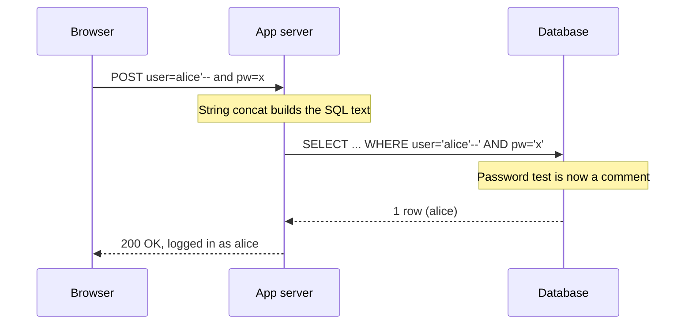

# Day 8: SQL injection

## Warm-up recall

Two minutes. Try to answer from memory before opening anything.

**Q (Day 6, HTTP, cookies, sessions):** A session cookie is stolen two different ways: by injected JavaScript and by a cross-site request that rides the browser's automatic cookie sending. Which cookie attributes address each, and what does each actually do?

<details>
<summary>Show answer</summary>

`HttpOnly` hides the cookie from `document.cookie`, so injected script cannot read it. It does not stop script from making requests that carry it.

`SameSite=Lax` or `Strict` stops the browser attaching the cookie to most cross-site requests, which blunts CSRF. `Secure` keeps it off plaintext HTTP.

</details>

## Threat feed

### `[CRIT]` Brotli decoder overflow ("HTTP2Shell") forces emergency patches across Node.js, Python and .NET

*Oct 26, 2026 · BleepingComputer · [source](https://www.bleepingcomputer.com/news/security/critical-http2shell-brotli-vulnerability-triggers-emergency-patches/) · `[NEW]` · relates to Day 6*

A crafted Brotli stream makes the C decoder treat an invalid block switch as "need more input" and keep appending to an eight-byte internal buffer, writing out of bounds. Per the report, BleepingComputer lists it as CVE-2026-111497, with fixes in Brotli 1.0.10, 1.1.1 and 1.2.1. Public proof-of-concept exists, but no in-the-wild exploitation was reported.

**Technical takeaway:** compressed bodies (`Content-Encoding: br`) are untrusted input too. The parser runs before your app logic, so WAF and validation never see it. Apps that bundle their own Brotli copy need a rebuild, not just an OS update.

### `[WARN]` AI coding agents hijacked by a planted AGENTS.md in the Downloads folder

*Oct 25, 2026 · BleepingComputer · [source](https://www.bleepingcomputer.com/news/security/ai-coding-agents-hijacked-using-agentsmd-file-in-downloads-folder/) · `[INFO]`*

Forever Security researchers found a malicious AGENTS.md on a customer machine. When an agent ran with Downloads as its working directory, it followed the file and tried to install a rogue npm package. They reproduced it against OpenAI Codex and showed a related CLAUDE.md technique against Claude Code.

**Technical takeaway:** same root idea as SQL injection: instructions and data share one channel. The agent cannot tell project config from attacker-supplied text. Today's fix, scoping the working directory, is the AI equivalent of least privilege.

### `[CRIT]` Japan Airlines customer data stolen via IT provider Amadeus

*Oct 28, 2026 · The Record · [source](https://therecord.media/japan-airlines-warns-of-breach-country-grapples-with-incidents) · `[NEW]`*

JAL says attackers accessed part of its reservation data held by Amadeus. About 92,000 customers had names, reservation codes and flight details exposed. Around 2,000 also lost passport numbers and contact data. Attackers are not identified, and JAL says card numbers were not affected.

**Technical takeaway:** the data lived in a third party's database, so JAL's own controls were not the control that failed. Third-party data stores inherit the same injection, access and logging risks as your own.

**GRC angle:** what contract terms require Amadeus-style providers to notify you, and how fast? Check breach-notification SLAs, data minimization of passport fields, and whether your vendor reviews cover the sub-processor holding your data.

## The idea

**SQL injection happens when user input is concatenated into a query string, so the database parser can no longer tell where your code ends and their data begins.**

> **Analogy:** A form says "Pay to the order of: ______". You write "Bob. Also pay Alice $1,000" in the blank. The clerk reads the whole line as an instruction because the blank and the form share one sheet. Parameterized queries put the blank on a separate, sealed slip.

## Why it matters

In May 2023, the Cl0p ransomware gang exploited `CVE-2023-34362`, a previously unknown SQL injection in Progress Software's MOVEit Transfer. They planted a web shell on internet-facing instances and stole data from the databases behind them, hitting a long tail of organizations through one file-transfer product. CISA and the FBI published a [joint advisory](https://www.cisa.gov/news-events/news/cisa-and-fbi-release-advisory-cl0p-ransomware-gang-exploiting-moveit-vulnerability).

## How it works

1. The app builds SQL by string concatenation: `"... WHERE user='" + name + "' AND pw='" + pw + "'"`.
2. The attacker sends a quote character in a field. The quote closes the string literal early.
3. Everything after the quote is parsed as SQL grammar, not as a value. `--` comments out the rest of the original query.
4. The database executes one statement whose structure the attacker chose. The app sees a normal result set and logs in, or dumps rows.



The quote ends the string literal and `--` comments out the password test. The database never saw a password check.

```python
# BAD: input becomes SQL grammar
q = f"SELECT id FROM users WHERE name='{name}' AND pw_hash='{h}'"
cur.execute(q)

# GOOD: query shape sent first, values bound separately
cur.execute("SELECT id FROM users WHERE name=? AND pw_hash=?", (name, h))
```

**Attacker sees:** error messages, response length differences, or timing. Each is an oracle: "did my quote break the syntax?" "did the condition return rows?" Same page with and without a clause means a boolean oracle exists.

**Defender sees:** an odd `name` value in access logs, SQL syntax errors in app logs, or DB audit logs showing a query with a shape never seen before and a comment token in the middle.

Variants to recognize by name:

- **In-band:** UNION or error output shown in the page.
- **Blind boolean:** true/false page differences.
- **Blind time-based:** `SLEEP` / `pg_sleep` delays.
- **Out-of-band:** DNS or HTTP callback from the database.
- **Second-order:** the payload is stored safely, then concatenated unsafely later by another code path.

## Common misconceptions

- **"Escaping quotes fixes it."** Escaping is brittle: numeric contexts need no quotes, encodings and database-specific rules differ, and one missed path undoes it. Binding is structural, escaping is cosmetic.
- **"An ORM makes us immune."** ORMs parameterize the common paths. Raw fragments, dynamic `ORDER BY` column names and string-built filters are still injectable.
- **"A WAF handles it."** A WAF is a speed bump with bypasses. Treat it as detection and virtual patching, not the fix.
- **"Parameters protect table and column names."** They do not. Identifiers cannot be bound. Use an allowlist mapping.

## Attacker abuse

`ATT&CK T1190` · `CWE-89` · `OWASP A03:2021 Injection`

MITRE T1190 (Exploit Public-Facing Application, Initial Access) lists SQL injection as a technique used by groups such as APT28 and APT41, and names sqlmap as an automation tool ([MITRE](https://attack.mitre.org/techniques/T1190/)). CWE-89 is "Improper Neutralization of Special Elements used in an SQL Command" ([CWE](https://cwe.mitre.org/data/definitions/89.html)). OWASP files it under A03:2021 Injection ([OWASP](https://owasp.org/Top10/2021/A03_2021-Injection/index.html)).

Typical goals: auth bypass, reading other tables, modifying authorization data, and on some configurations reaching the OS through database features. The real damage usually depends on how much the application's DB account is allowed to do.

## Defender playbook

**Prevent:** parameterized queries or prepared statements everywhere; allowlist-map dynamic identifiers; least-privilege DB accounts (no DDL, no file or OS features, per-service accounts); generic error pages; a SAST rule for string-built SQL in CI.

**Detect:** web logs plus DB error logs. Look for quote and comment tokens in parameters, bursts of 500s on one endpoint, and slow responses with a round-number delay.

```text
203.0.113.50 - - [29/Oct/2026:09:14:02 +0000] "POST /login HTTP/1.1" 200 1432 "user=alice%27--&pw=x"
203.0.113.50 - - [29/Oct/2026:09:14:09 +0000] "GET /items?id=1%20AND%20SLEEP(5) HTTP/1.1" 200 812 rt=5.01
198.51.100.7 - - [29/Oct/2026:09:14:31 +0000] "GET /items?id=1%27 HTTP/1.1" 500 310 rt=0.02
```

```yaml
title: SQL Injection Tokens In Web Request
logsource: {category: webserver}
detection:
  sel:
    cs-uri-query|contains: ["'--", "%27--", "union select", "sleep(", "pg_sleep("]
  condition: sel
level: medium
tags: [attack.initial_access, attack.t1190]
```

```text
alert http any any -> $HOME_NET any (msg:"SQLi union select in URI"; flow:established,to_server;
  http.uri; content:"union"; nocase; content:"select"; nocase; distance:0; sid:1000001; rev:1;)
```

> **Warning:** Signatures are noisy and easy to evade with encoding or comments. Correlate: a signature hit plus a 500 spike or an abnormal response size is much stronger than either alone.

## Hands-on lab (optional)

About 20 minutes, entirely local. This uses an in-memory SQLite database you create yourself.

```python
import sqlite3
db = sqlite3.connect(":memory:")
db.execute("CREATE TABLE users(name TEXT, pw TEXT)")
db.execute("INSERT INTO users VALUES('alice','s3cret'),('bob','hunter2')")

def bad(n, p):
    q = f"SELECT name FROM users WHERE name='{n}' AND pw='{p}'"
    print("SQL:", q); return db.execute(q).fetchall()

def good(n, p):
    return db.execute("SELECT name FROM users WHERE name=? AND pw=?", (n, p)).fetchall()

for n in ["alice", "alice'--"]:
    print("bad ", n, bad(n, "wrong"))
    print("good", n, good(n, "wrong"))
```

Run `python3 sqli_lab.py`. Look for: `bad alice'--` returns a row with the wrong password, the printed SQL shows the comment swallowing the password test, and every `good` line returns `[]`. Then extend it: enable the SQLite error-printing path and note which inputs raise syntax errors.

```bash
docker run --rm -p 127.0.0.1:3000:3000 bkimminich/juice-shop   # bind to localhost only
```

Free practice: [PortSwigger Web Security Academy, SQL injection labs](https://portswigger.net/web-security/sql-injection) (start with "retrieving hidden data").

## Portfolio idea

Build `sqli-lint`: a small Python AST script that flags `execute()` calls whose first argument is an f-string, `%` format or concatenation. Ship it with a test corpus and a GitHub Action. A short write-up of false positives makes it portfolio-grade.

## Teach it back

Explain SQL injection to a non-technical colleague in three sentences.

<details>
<summary>Show answer</summary>

Websites ask a database questions using text, and some sites paste whatever a visitor types straight into that text. A visitor can type a few special characters that turn their input into new instructions for the database. The fix is to send the question and the visitor's answer separately so the answer can never be mistaken for a question.

</details>

## Self-check

**1. (Recall)** Why does a prepared statement stop injection when escaping often does not?

<details>
<summary>Show answer</summary>

The query structure is parsed and planned before values arrive. Values are bound as data, so no value can change grammar. Escaping tries to neutralize characters inside a still-concatenated string, which depends on getting every context right.

</details>

**2. (Application)** A search page takes `?sort=price` and puts it in `ORDER BY`. Can you bind it as a parameter? What do you do?

<details>
<summary>Show answer</summary>

No. Identifiers and keywords cannot be bound. Map allowed inputs to fixed column strings (`{"price":"price","name":"name"}`) and reject anything else.

</details>

**3. (Scenario)** Your SIEM shows 400 requests to `/items?id=` from one IP with `sleep(` in the query, each taking about 5 seconds. Logs show 200 responses. What do you do?

<details>
<summary>Show answer</summary>

Treat it as probable time-based blind SQLi that may be succeeding, since 200s do not mean safe. Block or rate-limit the source, preserve logs, check DB audit logs for the query shapes and for any data access beyond normal, review the DB account's privileges, open an incident, and patch the endpoint with parameterization. Check whether other endpoints share the vulnerable helper.

</details>

## Go deeper

- [OWASP SQL Injection Prevention Cheat Sheet](https://cheatsheetseries.owasp.org/cheatsheets/SQL_Injection_Prevention_Cheat_Sheet)
- [CWE-89](https://cwe.mitre.org/data/definitions/89.html) and [ATT&CK T1190](https://attack.mitre.org/techniques/T1190/)
- [OWASP Top 10 A03:2021 Injection](https://owasp.org/Top10/2021/A03_2021-Injection/index.html)

**Where this shows up in your work:** NIST 800-53 SI-10 (information input validation) and SA-11 (developer testing), and SOC 2 CC7.1 / CC8.1 for vulnerability detection and change control.

**Certs:** Security+ (application attacks, secure coding), CySA+ (log analysis, vulnerability response), Pentest+ (web exploitation).

Next up: Day 9, cross-site scripting (XSS) and Content Security Policy.
