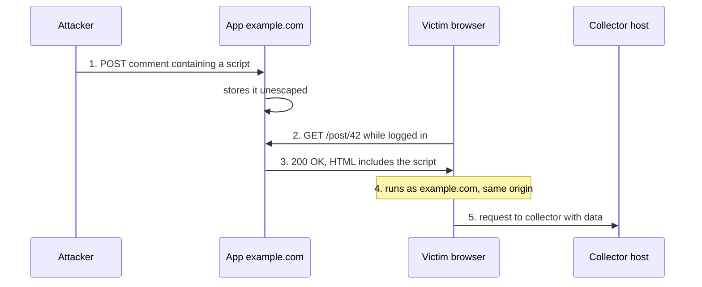

# Day 9: XSS and CSP

## Warm-up recall

Try answering both from memory before opening the answers.

**A. (SQL injection lesson)** Why does a parameterized query stop injection even when the input contains a quote character?

<details><summary>Show answer</summary>

The statement structure is sent to the database separately from the values. The SQL is parsed with placeholders first, then the values are bound as pure data, so a quote inside a value is never re-parsed as SQL syntax. String concatenation fails because data and code travel in one channel and get parsed together.

</details>

**B. (Day 1, TCP)** How does a SYN flood exhaust a server, and how do SYN cookies defend against it?

<details><summary>Show answer</summary>

Spoofed SYNs leave many half-open connections (`SYN_RECV`) that fill the backlog queue, and the final ACK never arrives. With SYN cookies the server encodes the state into its initial sequence number (a keyed hash of the 4-tuple plus a timestamp and MSS code) and keeps no state. It only allocates a connection if a returning ACK carries a valid cookie plus one.

</details>

## Threat feed

*Checked Oct 30, 2026. Only verified items are listed. Three verified items were found in the last few days, and no verified AI-security item inside that window.*

### `[CRIT]` Linux "Fragnesia" root bug and PHP2Shell chain land on CISA's KEV list

*Help Net Security, Oct 29, 2026. [Article](https://helpnetsecurity.com/2026/10/29/php2shell-fragnesia-vmware-esx-zero-day)*

CISA added Linux kernel local privilege escalation CVE-2026-46300 (Fragnesia) to the Known Exploited Vulnerabilities catalog on Oct 28 with a remediation deadline of Oct 31. CISA says it can be chained with PHP2Shell flaws to drop PHP webshells and run commands as root. Palo Alto Networks updated its advisory on Oct 29 saying exploitation targets management interfaces exposed to the internet.

**Technical takeaway:** a web-layer foothold (webshell as the web user) plus a local kernel bug gives root. Fixing only one link leaves the other, and management planes should never face the internet. `T1505.003`

### `[CRIT]` China-nexus "Warp Panda" used a VMware ESX zero-day that blinded audit logs

*Help Net Security, citing CrowdStrike, Oct 29, 2026. [Article](https://helpnetsecurity.com/2026/10/29/php2shell-fragnesia-vmware-esx-zero-day)*

CVE-2026-41709 is described as an insufficient-logging flaw in Broadcom's ESX hypervisor, fixed in July 2026. CrowdStrike says Warp Panda exploited it as a zero-day earlier in 2026 to cut audit-trail visibility, entering through edge devices, pivoting to vCenter, and stealing Microsoft 365 session tokens. CISA added it to KEV on Oct 28 with a Nov 11 deadline.

**Technical takeaway:** attackers attack the detection layer itself. Stolen session tokens are the same prize an XSS payload goes after. `T1539`

**GRC angle:** if a hypervisor can lose its own audit trail, are logs forwarded off-host in real time (NIST 800-53 AU-9, AU-4), and does the vendor-risk questionnaire ask how a vendor protects log integrity?

### `[WARN]` Sony Network Communications: 2.5 million customer records exposed

*BleepingComputer, Oct 28, 2026. [Article](https://bleepingcomputer.com/news/security/sony-isp-subsidiary-data-breach-exposes-25-million-customer-records)*

The So-net member database was accessed on Oct 19 and detected four days later. Sony announced it Oct 27. About 2,585,481 records (names, phones, emails, user IDs, birth dates) were exposed, plus 54,401 email addresses with passwords. The entry point has not been disclosed and no payment data was involved.

**Technical takeaway:** a four-day dwell before detection. Leaked contact data fuels phishing, and NTT Docomo already warned of fake sites. `T1078` `T1566`

## The idea

Cross-site scripting happens when a site puts untrusted data into a page in a way the browser interprets as code, so the attacker's JavaScript runs with the victim's identity on the victim's origin. Content Security Policy is a second lock: a response header that tells the browser which scripts it may run, even if the first lock failed.

**Analogy:** a restaurant prints guest comments onto the menu. Someone writes an instruction aimed at waiters, and every diner who reads the menu now carries an order that waiters obey, because the menu is trusted. Output encoding prints comments in a box labelled "quote, not instruction". CSP is a manager who only accepts instructions stamped with a secret seal.

## Why it matters

**Samy worm, MySpace, October 2005.** A profile field let through script-capable markup. The payload added its author as a friend and copied itself to the viewer's own profile. More than one million profiles ran it in about 20 hours. The author was raided in 2006 and pleaded guilty to a felony in 2007. [Source](https://en.wikipedia.org/wiki/Samy_(computer_worm))

## How it works

Three flavours share one root cause:

1. **Reflected:** the payload is in the request. The server echoes it into the response and the victim has to click a crafted link.
2. **Stored:** the payload is saved (comment, profile, ticket) and served to everyone who views it.
3. **DOM-based:** the server is never involved. Client JavaScript moves a source (`location.hash`, `document.referrer`) into a dangerous sink (`innerHTML`, `document.write`, `eval`).

The bug in four lines:

```python
@app.get("/search")
def search():
    q = request.args.get("q", "")
    return f"<h1>Results for {q}</h1>"   # raw string into HTML
```

Requesting `/search?q=<script>alert(document.domain)</script>` makes the browser parse the response as HTML, so the injected text becomes a real script element. The harmless `alert` proves which origin you are executing in.

Stored XSS step by step:



**Attacker sees:** a hit on a host they control.

```text
198.51.100.7 "GET /c?d=EXAMPLE HTTP/1.1" 200
```

**Defender sees:** unusual markup in a stored field, odd outbound requests from a user's browser, and CSP violation reports if configured.

```json
{"csp-report": {"violated-directive": "script-src", "blocked-uri": "inline"}}
```

DOM XSS, source to sink:

```javascript
// vulnerable: URL fragment flows into innerHTML
document.getElementById("greet").innerHTML = location.hash.slice(1);

// fixed: treat as text
document.getElementById("greet").textContent = location.hash.slice(1);
```

The fragment is never sent to the server, so server logs and WAFs cannot see DOM XSS.

## Common misconceptions

- **"HTML-encoding everything fixes it."** Encoding must match the context: HTML body, attribute, JavaScript string, URL, and CSS each have different dangerous characters, and `javascript:` URLs need scheme allowlisting.
- **"HttpOnly cookies make XSS harmless."** HttpOnly only stops cookie reads. The script still runs same-origin and can call APIs or submit forms as the user.
- **"CSP replaces output encoding."** CSP is defense in depth. Allowlist policies are often bypassable through JSONP endpoints or permissive CDNs, and `'unsafe-inline'` cancels most of the value.
- **"Modern frameworks are immune."** They escape by default, but escape hatches such as `dangerouslySetInnerHTML` reintroduce the bug.

## Attacker abuse

`CWE-79` `T1539` `T1185`

Attackers use XSS to steal session tokens (T1539), act inside the victim's authenticated browser (T1185), rewrite pages for phishing, log keystrokes in a form, or turn an admin's session into account takeover. XSS is still current: Microsoft Exchange XSS flaw CVE-2026-42897 (CVSS 8.1) is listed in CISA's KEV catalog, added May 15, 2026, according to [isitpatched.com](https://isitpatched.com/cve/CVE-2026-42897).

## Defender playbook

**Prevent**

- Contextual output encoding through an auto-escaping template engine. Treat raw-HTML helpers as code-review red flags.
- Avoid dangerous sinks and prefer `textContent`. For rich text, sanitize with a maintained library such as DOMPurify.
- Trusted Types, so sinks accept only vetted objects.
- Cookie flags `HttpOnly; Secure; SameSite=Lax` to limit blast radius.
- CSP with nonces rather than host allowlists:

```http
Content-Security-Policy: default-src 'self'; script-src 'nonce-R4ndomPerResponse' 'strict-dynamic'; object-src 'none'; base-uri 'none'; frame-ancestors 'none'; report-uri /csp-report
Set-Cookie: sid=EXAMPLE; HttpOnly; Secure; SameSite=Lax; Path=/
```

The nonce must be unpredictable and different on every response. Run with `Content-Security-Policy-Report-Only` first to find breakage.

**Detect**

```text
203.0.113.50 - - [30/Oct/2026:14:02:11 +0000] "GET /search?q=%3Cscript%3Ealert(document.domain)%3C/script%3E HTTP/1.1" 200 1432
```

```yaml
title: Possible XSS probe in web request
logsource: {category: webserver}
detection:
  selection:
    cs-uri-query|contains:
      - '<script'
      - '%3Cscript'
      - 'onerror='
      - 'javascript:'
  condition: selection
falsepositives: [security scanners, pentests]
level: medium
```

```text
alert http $EXTERNAL_NET any -> $HOME_NET any (msg:"EXAMPLE script tag in URI"; flow:established,to_server; http.uri; content:"<script"; nocase; sid:1000001; rev:1;)
```

A probe in a log means someone tried, not that it worked. Pair it with response size changes and CSP violation reports. DOM XSS will not appear in server logs.

## Hands-on lab (optional)

About 20 to 25 minutes, all local. Only test systems you own.

**Part 1: a reflecting page with and without CSP**

```python
import html
from http.server import BaseHTTPRequestHandler, HTTPServer
from urllib.parse import urlparse, parse_qs

class H(BaseHTTPRequestHandler):
    def do_GET(self):
        u = urlparse(self.path); q = parse_qs(u.query).get("q", [""])[0]
        if u.path == "/vuln":      body = f"<h1>Hi {q}</h1>"
        elif u.path == "/fixed":   body = f"<h1>Hi {html.escape(q)}</h1>"
        else:                      body = "try /vuln?q=x or /fixed?q=x"
        self.send_response(200)
        self.send_header("Content-Type", "text/html")
        if u.path == "/csp":       # inline scripts blocked
            self.send_header("Content-Security-Policy", "script-src 'self'")
            body = f"<h1>Hi {q}</h1>"
        self.end_headers(); self.wfile.write(body.encode())

HTTPServer(("127.0.0.1", 8000), H).serve_forever()
```

```bash
python3 xsslab.py &
curl -s 'http://127.0.0.1:8000/vuln?q=<b>x</b>'
curl -s 'http://127.0.0.1:8000/fixed?q=<b>x</b>'
curl -sI 'http://127.0.0.1:8000/csp?q=x' | grep -i content-security
```

Expected: `/vuln` returns raw `<b>`, `/fixed` returns `&lt;b&gt;`, and the third prints the CSP header. In a browser, open `/vuln?q=<script>alert(document.domain)</script>`, then the same payload on `/csp`, and watch the console report the blocked inline script.

**Part 2: Juice Shop DOM XSS**

```bash
docker run --rm -p 127.0.0.1:3000:3000 bkimminich/juice-shop
```

Browse to `http://127.0.0.1:3000`, open the scoreboard, and find the DOM XSS challenge. Identify the source and the sink before trying a payload.

**External practice:** [PortSwigger Web Security Academy XSS labs](https://portswigger.net/web-security/cross-site-scripting) (free).

## Portfolio idea

Build `xss-vuln-vs-fixed`: a tiny Flask app with a vulnerable and a fixed route, a pytest suite asserting payloads come back escaped, and a CSP report collector that writes violations to JSON. Add the Sigma rule above and a write-up of how each layer failed or held.

## Teach it back

Explain XSS and CSP to a non-technical colleague in 3 sentences.

<details><summary>Show answer</summary>

Some websites show what users type without checking it, so an attacker can type a tiny program that then runs inside other people's browsers as if the website wrote it. That program can act as the victim, for example reading their session or sending requests. Fixing it means the site treats typed text strictly as text, and a security policy header acts as a backup by telling the browser which programs it is allowed to run.

</details>

## Self-check

**1. (Recall)** Which XSS type never touches the server, and why can a WAF not see it?

<details><summary>Show answer</summary>

DOM-based XSS. The payload sits in the URL fragment or another client-side source and flows to a sink in browser JavaScript. Fragments are not sent in HTTP requests, so server and WAF logs never contain them.

</details>

**2. (Application)** You set `HttpOnly` on the session cookie, but a stored XSS still exists. Name two things an attacker can do.

<details><summary>Show answer</summary>

Make same-origin API calls with the user's cookies attached (change email, create API keys, post content), and modify the page to phish credentials or log keystrokes. HttpOnly only blocks reading the cookie value.

</details>

**3. (Scenario)** A developer proposes `script-src 'self' 'unsafe-inline' https://cdn.example.org` as the new CSP. What do you say?

<details><summary>Show answer</summary>

Reject it. `'unsafe-inline'` allows injected inline scripts and cancels most of the protection, and a broad CDN host can serve attacker-usable scripts. Propose a nonce-based policy with `strict-dynamic`, deploy in report-only mode first, fix inline handlers, and keep output encoding as the primary control.

</details>

## Go deeper

- [MDN: Content Security Policy (CSP)](https://developer.mozilla.org/en-US/docs/Web/HTTP/Guides/CSP)
- [PortSwigger: Cross-site scripting](https://portswigger.net/web-security/cross-site-scripting)
- [MITRE CWE-79](https://cwe.mitre.org/data/definitions/79.html) and [ATT&CK T1539](https://attack.mitre.org/techniques/T1539)

**Where this shows up in your work:** input validation and output filtering controls (NIST 800-53 SI-10 and SI-15), secure development testing (SA-11), and SOC 2 change-management and vulnerability-management criteria.

**Certification objectives:** reinforces Security+ application-attack and secure-coding objectives, and web-attack content for CySA+ and Pentest+.
